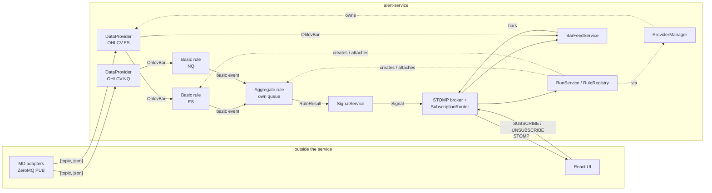
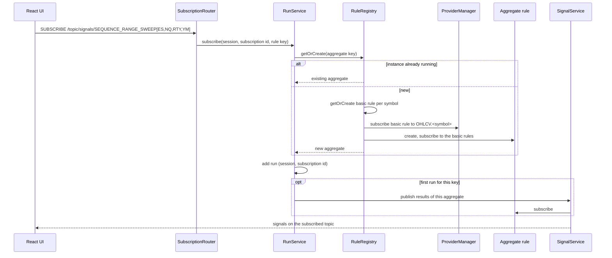

# Architecture: Overview

How the Java service is built. The business side (what the quarterly theory is, what each rule tests) lives in [[00_overview]] and [[00_rules_engine]]; this folder only describes how the service implements it.

## Design principles

| Principle | What it means here |
|-----------|--------------------|
| Event driven | Nothing polls. Market data arrives on ZeroMQ, flows through rules as events, and leaves as signals on a WebSocket. |
| Low coupling | A component only knows the type of event it consumes and the type it emits. A source never knows who listens to it. |
| High cohesion | One component, one job: a provider decodes one topic, a basic rule watches one instrument, an aggregate makes one decision. |
| Event time only | Rules only use bar timestamps (UTC), never the wall clock. Live data and a replay give the same results. |
| Shared, not duplicated | Two users asking for the same rule get the same rule instance; two rules needing the same topic get the same provider. |
| Open for new rules | Adding a rule means adding classes, not changing the core (providers, registry, signal pipeline). |

## Components

| Component | Responsibility | Note |
|-----------|----------------|------|
| `TimeGrid` | Maps a UTC timestamp to its position in the quarterly grid (6h, 90m, 22.5m, 5.625m) | [[01_time_grid]] |
| `DataProvider`, `ProviderManager` | One ZeroMQ SUB per topic; creating, sharing and closing providers | [[02_market_data_ingestion]] |
| `Source`, `Listener`, `Subscription` | The one mechanism every component uses to pass events on | [[03_sources_and_subscriptions]] |
| `RuleState`, `RuleInstance`, basic and aggregate rules | What a rule is made of | [[04_rule_model]] |
| `RuleRegistry`, `RunService` | Creating, sharing and stopping rule instances for the client subscriptions that need them | [[05_rule_lifecycle]] |
| Sequence range sweep | First real rule, mapped onto the model | [[06_sequence_range_sweep_design]] |
| `SignalService`, `SubscriptionRouter` | Turning results into signals and pushing them to the React UI; subscriptions start rules and feeds | [[07_signals_and_ui]] |
| `BarFeedService`, `BarStore` | Live 1-second bars and today's bars for charts | [[10_live_bars]] |
| Open questions | What is still undecided | [[08_architecture_open_questions]] |
| Build and run | Gradle, configuration, Docker | [[09_build_and_run]] |
| UI | React app in `project/ui`: chart of the four OHLC lines with signal markers | [[11_ui]] |

## Event flow



Every arrow between two components in the service is a [[03_sources_and_subscriptions]] subscription.

## What happens on a subscription



## Decisions taken (2026-10-11)

| Topic | Decision |
|-------|----------|
| Rule structure | `RuleState` (data only) + `RuleInstance` (state + logic). Rules are basic (one instrument) or aggregate (combines basic rules and decides). |
| Data requirement | Each rule class declares a static requirement (data type); the user request adds the symbols. |
| Dispatch | Each source keeps its own listener list. No central engine. Aggregates have their own event queue. |
| Unsubscribe | Through a `Subscription` handle carrying the subscriber's id, not by removing a method reference. |
| Sharing | One instance per rule key; extra users attach to it. |
| Time grid anchor | 18:00 New York time (CME Globex open). Timestamps in and out stay UTC. |
| Grid levels | 6h, 90m, 22.5m, 5.625m. A bar belongs to the window containing its start time. |
| Bar size | Always 1-second bars, guaranteed by the adapters. Not carried in topics or payloads. |
| ZeroMQ | Multipart `[topic, json]`, topics `OHLCV.<SYMBOL>`, one provider per topic. |
| Late start | A rule declares the earliest block it must observe; if it starts later the trading day is invalid for it. |
| UI transport | WebSocket with STOMP (not SSE, not gRPC). An external message broker can be put behind it later. |
| Commands | None: subscribing to a topic starts the rule or bar feed it names, unsubscribing or disconnecting stops it. Errors arrive on the subscribed topic (decided later the same day) |
| Symbols | Come with each request. |

## Decisions taken (2026-10-24)

| Topic | Decision |
|-------|----------|
| STOMP | Confirmed as the protocol on top of WebSocket |
| Trading day name | CME trade date: the session opening Sunday 18:00 New York is Monday's trading day |
| Security | `spring-boot-starter-security` removed for iteration 1; server bound to localhost |
| Late attach | Sources are hot (live only, no replay). Basic rules check their first bar against a block; aggregates check that they received their required facts live in time |
| User model | `RunService` keeps the active runs (one per client subscription to a rule's topic); the last run of a rule tears it down. `SignalService` holds one subscription per aggregate and publishes to its STOMP topic |

## Decisions taken while implementing (2026-10-24)

| Topic | Decision |
|-------|----------|
| Packages | `RunService` and the STOMP gateway moved out of `rule` and `signal` into `run` and `api`, so packages only depend downward (no cycle) |
| Range status | A basic rule that has no range today says so (`RangeUnavailable`); the aggregate judges the day once every symbol's range status is known ([[06_sequence_range_sweep_design]]) |
| Message order | Each STOMP session's frames are handled in the order sent, and signals reach it in the order published |
| Live bars | `/topic/bars/{symbol}` streams 1-second bars through `ProviderManager`, independently of rules; `BarStore` keeps today's bars in compact arrays (about 4 MB per symbol per day) |
| History | `GET /api/bars/{symbol}` and `GET /api/signals/{ruleKey}`; signals carry an `id` so a client merges live and history without gaps |
| Packaging | Executable jar via Gradle, Docker image via the `Dockerfile` ([[09_build_and_run]]) |

## Package layout

Arrows point from a package to what it uses.

```
com.alert_service
├── AlertServiceConfiguration   wires the framework-free core (grid, providers, registry)
├── timegrid        TimeGrid, GridPosition, GridLevel
├── event           Source, Listener, Subscription, ListenerList
├── marketdata      DataType, Topic, OhlcvBar, DataRequirement, OhlcvJsonDecoder
│   └── zmq         DataProvider, ZmqDataProvider, ProviderManager, ZmqProperties
├── rule            RuleInstance, BasicRule, AggregateRule, RuleState, RuleKey, RuleResult, descriptors,
│   │               factories, RuleRegistry                                  → event, marketdata, timegrid
│   ├── basic.rangebreak                  RangeBreakWatch and its events
│   ├── aggregate.sequencerangesweep      SequenceRangeSweep
│   └── mock                              NeverFiringRule
├── signal          SignalService, Signal, SignalPublisher                   → rule
├── run             RunService, SessionSubscriptions                         → rule, signal
├── bars            BarFeedService, BarStore, BarMessage, BarPublisher        → marketdata, run
└── api             StompConfig, SubscriptionRouter, SessionEvents, HistoryController,
                    StompSignalPublisher, StompBarPublisher, WebConfig        → run, signal, bars
```

Core classes (`ProviderManager`, `RuleRegistry`, rules, `TimeGrid`) carry no Spring annotations, so unit tests build them directly.
