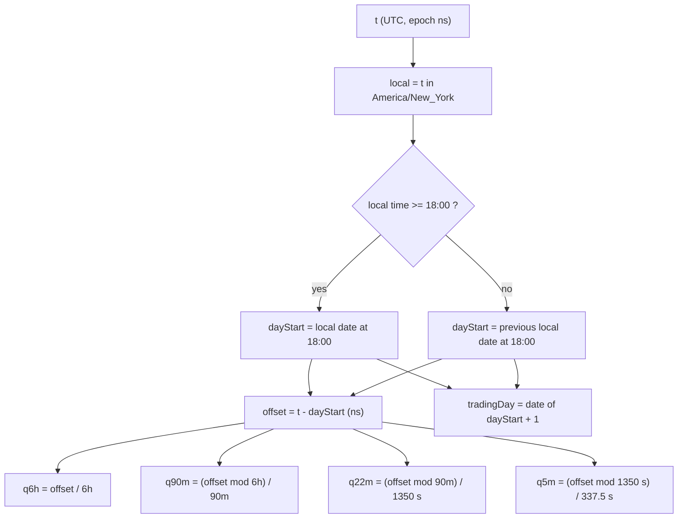

# Time Grid

Part of [[00_architecture_overview]]. Business definition of the windows: [[02_time_model]].

Every rule is built on the grid, so it is the component everything else depends on. It is pure: no state, no clock, no I/O. Same input, same output.

## Anchor

| Item | Decision |
|------|----------|
| Trading day start | **18:00 `America/New_York`**, the CME Globex open |
| Timestamps received | UTC, epoch nanoseconds (see [[06_market_data_contract]]) |
| Timestamps emitted | UTC |
| Where a time zone is used | Only to find the instant of the trading day start. Everything inside the day is a plain duration from that instant. |

The grid follows the market open, so it is fixed in New York time and moves by one hour in UTC when the US changes clocks.

## Levels

| Level | Length | Per parent | Per day | Exact with 1-second bars? |
|-------|--------|------------|---------|----------------|
| `L1` 6h quarter (session) | 6 h | 4 | 4 | yes |
| `L2` 90m quarter | 90 min | 4 | 16 | yes |
| `L3` 22.5m quarter | 22 min 30 s (1350 s) | 4 | 64 | yes |
| `L4` 5.625m quarter | 5 min 37.5 s (337.5 s) | 4 | 256 | half-second boundaries, see below |

All lengths are whole nanoseconds, so the mapping itself is exact integer arithmetic.

## GridPosition (data object)

| Field | Meaning |
|-------|---------|
| `tradingDay` | CME trade date: the New York date on which the session ends, i.e. the date of its 18:00 start + 1 day (the session opening Sunday 18:00 is Monday's) |
| `dayStart` | UTC instant of the 18:00 New York start |
| `q6h`, `q90m`, `q22m`, `q5m` | 0-3 each (Q1-Q4), the quarter at each level |
| `block(level)` | Block number within the day at that level: `L1` 0-3, `L2` 0-15, `L3` 0-63, `L4` 0-255 |
| `windowStart(level)`, `windowEnd(level)` | UTC bounds `[start, end)` of the window at that level |

Address notation: 0-based `(q6h, q90m, q22m, q5m)`. The rule notes write it 1-based, so 3-3-3 is `(2,2,2)` at `L3`, block 42.

## Mapping



Why this is safe: US clocks change on a Sunday at 02:00 New York time, inside the weekend gap (Friday 17:00 close to Sunday 18:00 open). So every trading day that carries data is exactly 24 h, and no window ever spans a clock change. The time zone rules come from `java.time` (tzdata bundled with the JDK), which is deterministic for a given JDK.

## Assigning a bar to a window

**A bar belongs to the window that contains its `startTime`.** Windows are half-open `[start, end)`.

Down to `L3` every boundary is a whole second, so a 1-second bar never straddles one. At `L4` every other boundary falls on a half second (`+337.5 s`, `+1012.5 s`). The bar starting at `+337 s` covers `[337, 338)`, contains the boundary, and belongs to the earlier window. In effect each half-second boundary is rounded up to the next whole second:

| `L4` quarter | Exact window (s from `L3` start) | Bars (start seconds) | Count |
|--------------|----------------------------------|----------------------|-------|
| Q1 | 0 - 337.5 | 0 - 337 | 338 |
| Q2 | 337.5 - 675 | 338 - 674 | 337 |
| Q3 | 675 - 1012.5 | 675 - 1012 | 338 |
| Q4 | 1012.5 - 1350 | 1013 - 1349 | 337 |

Maximum error: 0.5 s, never accumulated (`L3` boundaries are exact). This is a fixed rule, not a user setting.

## The grid in New York time (same every day of the year)

| Session | NY time | 90m Q1 | 90m Q2 | 90m Q3 | 90m Q4 |
|---------|---------|--------|--------|--------|--------|
| Q1 Asia | 18:00-00:00 | 18:00-19:30 | 19:30-21:00 | 21:00-22:30 | 22:30-00:00 |
| Q2 London | 00:00-06:00 | 00:00-01:30 | 01:30-03:00 | 03:00-04:30 | 04:30-06:00 |
| Q3 NY AM | 06:00-12:00 | 06:00-07:30 | 07:30-09:00 | 09:00-10:30 | 10:30-12:00 |
| Q4 NY PM | 12:00-18:00 | 12:00-13:30 | 13:30-15:00 | 15:00-16:30 | 16:30-18:00 |

The CME daily halt (17:00-18:00 NY) is always the last hour of NY PM.

## The grid in UTC over a year

```
2026            Jan   Feb   Mar         Apr ... Oct         Nov   Dec
US clock        EST ─────────┤Mar 8 EDT ───────────────────┤Nov 1 EST ──────
UK clock        GMT ───────────────┤Mar 29 BST ──────┤Oct 25 GMT ───────────
                             ▲ US/UK out of sync ▲  ▲ out of sync ▲
Day start (UTC) 23:00 ───────┤22:00 ───────────────────────┤23:00 ──────────
3-3-3 (UTC)     14:45 ───────┤13:45 ───────────────────────┤14:45 ──────────
3-3-3 (NY)      09:45 all year
```

| Window | NY | UTC during EDT (2nd Sun Mar - 1st Sun Nov) | UTC during EST |
|--------|----|--------------------------------------------|----------------|
| Q1 Asia | 18:00-00:00 | 22:00-04:00 | 23:00-05:00 |
| Q2 London | 00:00-06:00 | 04:00-10:00 | 05:00-11:00 |
| Q3 NY AM | 06:00-12:00 | 10:00-16:00 | 11:00-17:00 |
| Q4 NY PM | 12:00-18:00 | 16:00-22:00 | 17:00-23:00 |
| 3-3-3 | 09:45:00-10:07:30 | 13:45:00-14:07:30 | 14:45:00-15:07:30 |
| 3-3-4 | 10:07:30-10:30:00 | 14:07:30-14:30:00 | 15:07:30-15:30:00 |

Known drift: the UK changes clocks on different dates (last Sunday of March / October), so the real London open (08:00 UK) moves one hour against the grid for about 4 weeks a year. Session names are labels; this is accepted.

## Test cases to start with

| Input (UTC) | Expected |
|-------------|----------|
| `2026-03-09T13:45:00Z` | trading day 2026-03-09 (Monday, session opened Sunday 2026-03-08 18:00 EDT, first EDT session), `(2,2,2,0)`, `L3` block 42 |
| `2026-01-16T14:45:00Z` | trading day 2026-01-16 (EST), `(2,2,2,0)`, `L3` block 42 |
| `2026-01-16T14:44:59Z` | `(2,2,1,3)` |
| `L3` start + 337 s / + 338 s | `q5m` 0 / 1 (half-second rule) |
| `2026-11-01T23:00:00Z` | trading day 2026-11-02 (Monday, session opened Sunday 18:00 EST, first EST session), `(0,0,0,0)` |
| `2026-11-01T22:59:59Z` | still the previous session (Sunday 17:59:59 EST): weekend gap, no bars expected |
| Every trading day 2020-2035 | `dayStart(next) - dayStart` = 24 h, except across weekends |

Holidays can make CME skip a trade date; the grid does not know the holiday calendar yet, so it always uses start date + 1 ([[08_architecture_open_questions]]).
