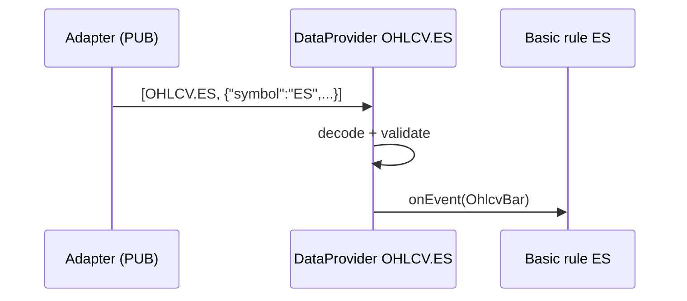

# Market Data Ingestion

Part of [[00_architecture_overview]]. Wire contract: [[06_market_data_contract]]. Event mechanism: [[03_sources_and_subscriptions]].

## Topics and messages

| Item | Decision |
|------|----------|
| Topic format | `<DATATYPE>.<SYMBOL>`, e.g. `OHLCV.ES` |
| Message | ZeroMQ multipart: frame 1 = topic, frame 2 = JSON payload |
| Who binds | Adapters bind their PUB sockets; the service connects SUB sockets to the endpoints listed in configuration |
| Bar size | Always 1 second, guaranteed by the adapters; not part of topics or payloads |

ZeroMQ matches subscriptions by prefix, so subscribing to `OHLCV.ES` would also receive a topic such as `OHLCV.ES2` if one ever existed. The provider therefore checks that the topic frame equals its topic exactly and drops anything else.

## DataProvider

One instance per topic. It is a `Source<E>` of decoded events.

| Responsibility | Detail |
|----------------|--------|
| Own one SUB socket | ZeroMQ sockets are not thread-safe, so the socket is created, used and closed on the provider's own thread |
| Decode | Frame 2 → typed event (`OhlcvBar` for `OHLCV`) via the decoder registered for the data type |
| Validate | Topic frame equals its topic; symbol in the payload matches the topic. Invalid messages are logged and dropped |
| Dispatch | Push each event to its listeners, on its own thread |
| Close | Stop the thread and close the socket when the manager tells it to |

A provider knows nothing about rules. It only knows its topic and its listener list.



## ProviderManager

Its clients: basic rules ([[05_rule_lifecycle]]) and bar feeds ([[10_live_bars]]). Neither knows the other; a provider is shared by whoever needs its topic.

The only shared service of the ingestion side. It manages lifecycle, nothing else.

| Method (intent) | Behavior |
|-----------------|----------|
| `subscribe(topic, eventType, subscriberId, listener)` | Get or create the provider for `topic`, add the listener, return a `Subscription`. `eventType` must be the topic's data type event (`OhlcvBar` for `OHLCV`) |
| `release(subscription)` | Remove the listener; if the provider has no listeners left, close it |
| `providers()` | Read-only view for diagnostics |

Get-or-create and close-when-empty must be atomic with respect to each other, otherwise a subscribe can land on a provider that is being closed. Both run under one lock in the manager (subscribing is rare, so the lock costs nothing).

## Data types

| Item | Now | Adding a type later |
|------|-----|---------------------|
| `DataType` | `OHLCV` | New enum value |
| Event | `OhlcvBar(symbol, startTime, open, high, low, close, volume)` | New record |
| Decoder | JSON → `OhlcvBar` | New decoder, registered for the type |

Nothing else changes: providers, the manager and the event mechanism are generic over the event type.

## DataRequirement

A rule class declares a static requirement, the request supplies the symbols, and the two together give the topics ([[04_rule_model]]).

```
static:   OHLCV                    (declared by the basic rule class)
request:  symbol ES                (from the user)
topic:    OHLCV.ES
```

## Out of scope for now, kept possible

- **Contract roll safety net.** The adapter rolls contracts at the trading-day boundary ([[01_instruments_and_data]]). Because each symbol has its own provider, a check (e.g. a price jump at the day boundary) can be added inside the provider later without touching rules.
- **Late and duplicate bars.** Not handled; bars are assumed ordered and unique per topic.
- **Library.** JeroMQ 0.6.0 (pure Java ZeroMQ). One shared `ZContext`; each provider creates, uses and closes its socket on its own thread. Configuration: [[09_build_and_run]].
