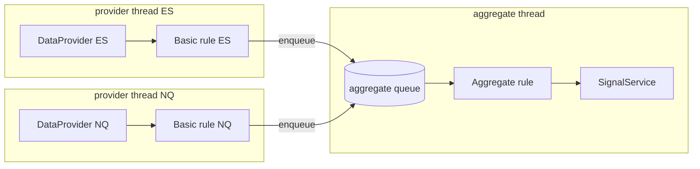

# Sources and Subscriptions

Part of [[00_architecture_overview]]. The single mechanism that moves events between components: providers ([[02_market_data_ingestion]]), basic rules, aggregate rules ([[04_rule_model]]) and the signal side ([[07_signals_and_ui]]).

## Shape

| Type | Role |
|------|------|
| `Listener<E>` | Receives events: `onEvent(E event)` |
| `Source<E>` | Emits events: `subscribe(subscriberId, Listener<E>)` returns a `Subscription` |
| `Subscription` | Handle for one listener on one source: `id`, `subscriberId`, `close()` |

| Component | Is a `Listener` of | Is a `Source` of |
|-----------|--------------------|------------------|
| `DataProvider` | (ZeroMQ) | `OhlcvBar` |
| Basic rule | one provider | its basic events |
| Aggregate rule | several basic rules | `RuleResult` |
| `SignalService` | aggregate rules | signals to users |

A source never knows what its listeners are; it only holds the list.

## Why a Subscription handle

In Java, `rule::onEvent` creates a new object every time it is evaluated, so `listeners.remove(rule::onEvent)` would never find the listener that was added. The handle returned by `subscribe` is what gets closed instead.

- `subscriberId` identifies the subscribing component (its rule key, see [[05_rule_lifecycle]]). It makes logs readable and makes subscribing twice idempotent: the same `subscriberId` on the same source returns the existing subscription.
- `close()` is idempotent and is the only way to unsubscribe.

## Listener list

Backed by `CopyOnWriteArrayList`.

| Question | Answer |
|----------|--------|
| Thread-safe for add and remove? | Yes. Every add or remove copies the array under an internal lock, so concurrent adds/removes from any thread are safe. |
| Safe while dispatching? | Yes. Dispatch iterates over a snapshot and never sees a half-made change. |
| Listener added during a dispatch | Receives events from the next one on. |
| Listener removed during a dispatch | May receive the event already in flight. Listeners must tolerate one late event. |
| Cost | O(n) per add/remove, nothing per dispatch. Lists hold a few listeners and change rarely. |

Each listener call is wrapped in its own try/catch: one failing listener is logged and does not stop the others or the provider thread.

## Sources are hot

Every source emits live only: a listener that attaches late does not receive what was emitted before. Nothing is replayed or stored for late listeners. A rule that attached too late to have the facts it needs detects it itself, through its late start check ([[04_rule_model]]).

## Threads

| Component | Runs on | Why it is safe |
|-----------|---------|----------------|
| `DataProvider` | its own thread | owns its socket |
| Basic rule | the thread of its one provider | only one thread ever calls it |
| Aggregate rule | its own thread, draining its own queue | inputs from several provider threads are serialized by the queue, in arrival order |
| `SignalService` | the calling aggregate's thread | stateless per call; the WebSocket layer is thread-safe |

Consequences:
- Basic rule work runs on the provider thread, so it must stay cheap (a few comparisons per bar).
- The aggregate queue is unbounded for now: volume is about one bar per second per symbol.
- No locks inside rules.
