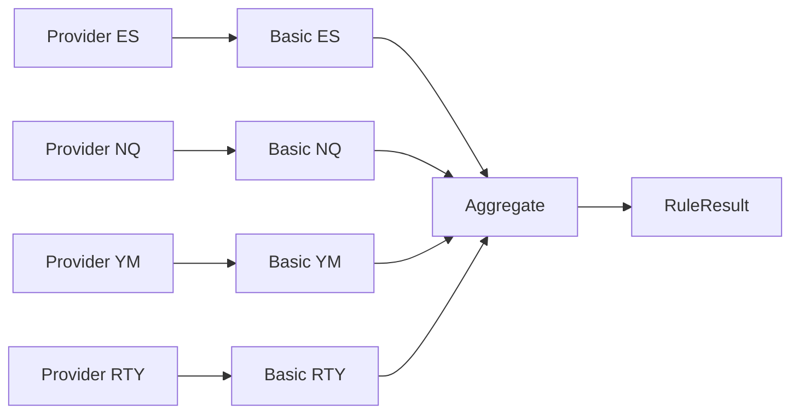
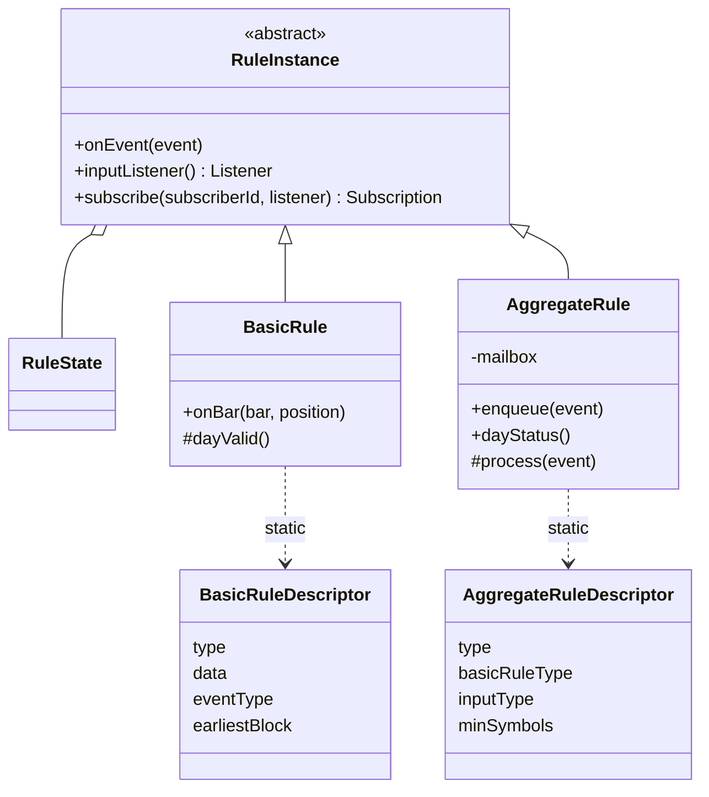

# Rule Model

Part of [[00_architecture_overview]]. Business side of rules: [[00_rules_engine]].

## RuleState and RuleInstance

| Object | Holds | Does |
|--------|-------|------|
| `RuleState` | Data only: captured values, flags, pending work | Nothing. No logic. |
| `RuleInstance` | Its `RuleState` + the logic | Receives events, updates its state, emits its own events |

A state belongs to exactly one instance and is only changed by it, on the instance's thread ([[03_sources_and_subscriptions]]). State is per trading day: it is reset when the first event of a new trading day arrives ([[01_time_grid]]).

## Two kinds of rule

| | Basic rule | Aggregate rule |
|-|------------|----------------|
| Scope | One instrument | Several instruments (through their basic rules) |
| Listens to | One `DataProvider` | Several basic rules, through its own queue |
| Emits | Facts about its instrument (e.g. range captured, extreme broken) | `RuleResult`, or nothing |
| Decides | Nothing; it reports facts | Everything: which facts matter, how they combine, when they are too far apart in time |
| Knows about the other kind | No | Only the types of basic events it consumes |
| Reused | Yes, by any aggregate needing it | Yes, by any user requesting it |

This keeps every rule's internals free while plugging into the system the same way, and lets one basic rule serve several aggregates.

## Static description

Every rule class exposes a public static descriptor. The request adds the user's input to it ([[05_rule_lifecycle]]).

| Field | Basic rule (`BasicRuleDescriptor`) | Aggregate rule (`AggregateRuleDescriptor`) |
|-------|------------|----------------|
| `type` | e.g. `RANGE_BREAK_WATCH` | e.g. `SEQUENCE_RANGE_SWEEP` |
| `data` | `DataRequirement(OHLCV)` | - |
| event types | `eventType`: the facts it emits | `inputType`: the facts it consumes |
| `basicRuleType` | - | the basic rule it needs, one instance per symbol |
| late start | `earliestLevel` + `earliestBlock`: first grid block it must observe | rule-specific: the facts it needs before it can judge the day |
| `minSymbols` | - | fewest symbols a request may name |
| parameters from the request | symbol | symbols |

Each rule type also has a factory (`BasicRuleFactory`, `AggregateRuleFactory`, Spring components) that the registry uses to create instances. At startup the registry checks that every aggregate's basic rule exists and emits the type the aggregate consumes.

## Late start check

A rule that starts watching after the data it needs began cannot be correct: the service never fetches history, and sources never replay ([[03_sources_and_subscriptions]]). The check only uses events actually received, and the result is per trading day: an invalid day is skipped, the instance keeps running, and the next trading day is checked again.

| Rule kind | Declares | Valid for the trading day when |
|-----------|----------|--------------------------------|
| Basic | `earliestBlock` (a [[01_time_grid]] block) | Its first bar of the day starts before `earliestBlock`. An invalid basic rule does not report its normal facts; it reports that it has none (for the range watch: `RangeUnavailable`), so its listeners can decide instead of waiting. |
| Aggregate | The facts it needs before it can judge the day | It received every required fact, live |

This also covers sharing: an aggregate attached too late to a running basic rule missed the facts (it sees later facts without the earlier ones), and one whose basic rule started too late is told so. Either way the day is reported as a `STATUS` result `INVALID_WINDOW`. The base classes do the day bookkeeping: a new `RuleState` at the first event of each trading day, and for basic rules the `earliestBlock` check.

## Output: RuleResult

Shape from [[00_rules_engine]], plus a `kind`:

| Field | Meaning |
|-------|---------|
| `kind` | `RESULT` (a verdict), `REPORT` (a fact worth showing, e.g. extremity passed), `STATUS` (e.g. `INVALID_WINDOW`) |
| `rule` | Rule type |
| `ruleKey` | The instance that produced it ([[05_rule_lifecycle]]) |
| `code` | What a `REPORT` or `STATUS` is about, e.g. `EXTREMITY_PASSED`, `INVALID_WINDOW` |
| `level` | Grid level the result refers to |
| `scope` | Instrument(s) |
| `verdict` | `BULLISH`, `BEARISH`, `NEUTRAL`, `DIVERGENCE` (for `RESULT`) |
| `eventTime` | Bar time that produced it (UTC) |
| `evidence` | The numbers behind it |

Whether a `RESULT` becomes a signal is decided outside the rule, in `SignalService` ([[07_signals_and_ui]]).

## Mock rule

`NEVER_FIRING`: an aggregate that subscribes to one basic rule per requested symbol (any existing basic rule, e.g. `RANGE_BREAK_WATCH`), consumes every event, and never emits a `RESULT`. It proves that a rule can be added without touching the core, and gives an end-to-end test of the subscription chain.

