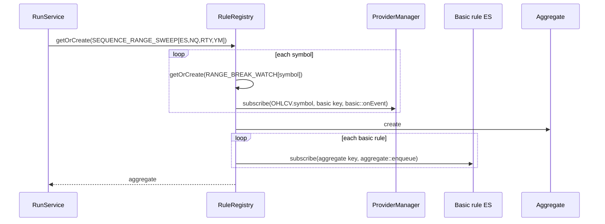
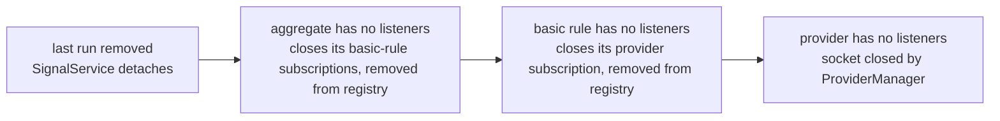

# Rule Lifecycle

Part of [[00_architecture_overview]]. What rules are: [[04_rule_model]]. How they connect: [[03_sources_and_subscriptions]].

## Request

```json
{ "rule": "SEQUENCE_RANGE_SWEEP", "symbols": ["ES", "NQ", "YM", "RTY"] }
```

Symbols always come from the request. The UI offers the four index futures for now.

## Rule keys

An instance is identified by its type and its normalized parameters. Same key, same instance.

| Rule | Key |
|------|-----|
| Aggregate | `SEQUENCE_RANGE_SWEEP[ES,NQ,RTY,YM]` (symbols sorted) |
| Basic | `RANGE_BREAK_WATCH[ES]` |

The key is also the `subscriberId` the instance uses when it subscribes to its inputs. Two aggregates with different symbol sets still share the basic rules of the symbols they have in common.

## RuleRegistry

Holds every running instance by key. Get-or-create and remove-when-unused are atomic with respect to each other (same reasoning as `ProviderManager`, [[02_market_data_ingestion]]).

Creation is bottom-up:



## RunService and runs

Users do not subscribe to aggregates directly: signals reach them through a STOMP topic, and subscribing to that topic is what starts the rule ([[07_signals_and_ui]]). What keeps an aggregate alive is a **run**: one client subscription (STOMP session, subscription id) to the rule's topic. `RunService` keeps the active runs, rule key → runs (via `SessionSubscriptions`, the same helper the bar feeds use):

```
SEQUENCE_RANGE_SWEEP[ES,NQ,RTY,YM] → { (session-A, sub-0), (session-B, sub-3) }
```

| Method (intent) | Behavior |
|-----------------|----------|
| `subscribe(ref, ruleKey)` | Validate the key (well formed, known rule, valid symbols, canonical), add the run. First run for a key: `SignalService` attaches to the aggregate, creating it (one subscription per aggregate, whatever the number of users) |
| `unsubscribe(ref)` | Remove the run. Last run for a key: `SignalService` detaches, dropping the history |
| `unsubscribeAll(session)` | Remove every run of the session; called when the STOMP session ends |

The same subscription arriving twice is idempotent (one run).

| Event | Runs for the key | Effect |
|-------|------------------|--------|
| A subscribes | `{A}` | Aggregate created, `SignalService` attaches |
| B subscribes to the same topic | `{A, B}` | Nothing new is created |
| A unsubscribes or disconnects | `{B}` | Nothing changes |
| B unsubscribes or disconnects | `{}` | `SignalService` detaches, teardown cascade below |

## Teardown cascade

Each level closes its inputs when it has no listeners left:



A basic rule still used by another aggregate stays, and so does a provider still used by another basic rule.

## Joining a running instance

- **A user joining a running aggregate** receives results from that moment on; `GET /api/signals/{ruleKey}` gives what was emitted before and the current day status, so a user joining an `INVALID_WINDOW` day knows why nothing will come today. No thread or computation is added.
- **An aggregate joining a running basic rule** receives live events only ([[03_sources_and_subscriptions]]). If it attached too late to receive the facts it needs, its late start check marks the day invalid ([[04_rule_model]]).

## Across days

Instances live until their last user leaves, across trading days. Each instance resets its `RuleState` at the first event of a new trading day and runs the late start check again ([[04_rule_model]]).
