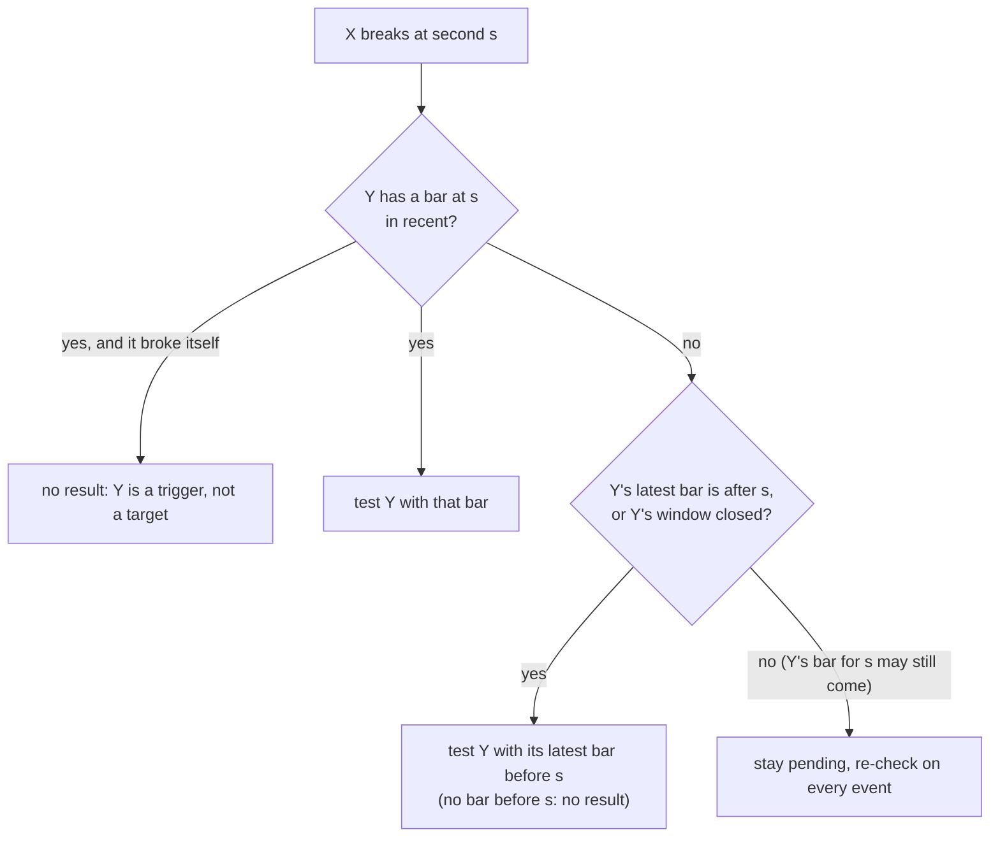

# Sequence Range Sweep: Design

Part of [[00_architecture_overview]]. The rule itself: [[sequence_range_sweep]]. Model: [[04_rule_model]].

As implemented in `rule.basic.rangebreak` and `rule.aggregate.sequencerangesweep`.

## Split

| Part | Instance | Job |
|------|----------|-----|
| Basic | `RANGE_BREAK_WATCH[symbol]`, one per symbol | Capture `H`, `L`, `M` of 3-3-3 for its instrument; during 3-3-4, report every bar's position against them and every break |
| Aggregate | `SEQUENCE_RANGE_SWEEP[symbols]` | Combine them: on a break by `X`, test every other `Y` at the same second and emit BUY / SHORT results |

Windows ([[01_time_grid]]): 3-3-3 = `L3` block 42 (09:45:00-10:07:30 NY), 3-3-4 = `L3` block 43 (10:07:30-10:30:00 NY).

## Basic rule: RANGE_BREAK_WATCH

| State | Meaning |
|-------|---------|
| `runningHigh`, `runningLow` | Running extremes during 3-3-3 |
| `high`, `low`, `mean` | `H`, `L`, `M`, frozen at the first bar of 3-3-4. `M = (H + L) / 2`, exact decimal |
| `phase` | `WAITING`, `CAPTURING`, `WATCHING`, `DONE` |

Facts, in this order per trading day:

| Event emitted | When | Content |
|---------------|------|---------|
| `RangeCaptured` | First bar at or after 3-3-4 start | symbol, trading day, `H`, `L`, `M` |
| `RangeUnavailable` | Instead of `RangeCaptured`, when the rule has no range today | reason: `LATE_START` (first bar of the day at or after 09:45:00 NY) or `NO_BARS_IN_RANGE` |
| `BarPositioned` | Every bar in 3-3-4 | second `s`, bar `high`, `low`, `brokeHigh` (`high > H`), `brokeLow` (`low < L`) |
| `WindowClosed` | First bar at or after 3-3-4 end | - |

A break is a `BarPositioned` with a break flag set, so the aggregate receives one ordered stream per symbol. `earliestBlock` = block 42.

## Aggregate rule: SEQUENCE_RANGE_SWEEP

| State | Meaning |
|-------|---------|
| `ranges` | `RangeCaptured` per symbol |
| `missingRanges` | Symbols that will have no range today |
| `recent` | Per symbol, the last 64 `BarPositioned` events |
| `closed` | Symbols whose `WindowClosed` arrived |
| `pending` | Checks (trigger, side, target) not decided yet |
| `signalled` | Targets that already got a result today (one per target per day) |

### Judging the day

Each symbol's stream is ordered, but streams of different symbols arrive in any order: the first 3-3-4 bar of ES can arrive before NQ's `RangeCaptured`. So the day is judged only once the range status of **every** symbol is known:

| A symbol's range status is known when | Status |
|---------------------------------------|--------|
| `RangeCaptured` arrived | captured |
| `RangeUnavailable` arrived | missing (basic rule started late, or no bars) |
| `BarPositioned` or `WindowClosed` arrived without a `RangeCaptured` before it | missing (this aggregate attached after the range was captured) |

All captured → day `VALID`. Any missing → `STATUS` result `INVALID_WINDOW` naming the symbols, and nothing else that day. Breaks seen before the day is judged are held as pending checks and evaluated as soon as it is `VALID`.

### Same-second resolution, event time only

When `X` breaks at second `s`, a check is added for every other `Y`. A check is decided by `Y`'s own stream:

Test (from [[sequence_range_sweep]]): low break → `BULLISH` (BUY) for `Y` if `Y.L <= low < Y.M`; high break → `BEARISH` (SHORT) if `Y.M < high <= Y.H`. A target already in `signalled` is skipped.

No timeout and no wall clock: every decision is driven by a later event, so replay and live behave the same.

Known limit: "one result per target per day" keeps the first check decided, not necessarily the earliest second. If `X`'s stream lags, a trigger by `Z` at a later second can be decided first. This needs two qualifying triggers within the cross-symbol delay (milliseconds), so it is accepted for iteration 1 ([[08_architecture_open_questions]]).

### Output

| Kind | When |
|------|------|
| `RESULT` `BULLISH` / `BEARISH` | A target qualifies; `eventTime` = trigger second `s`; evidence: trigger symbol, side, price; target bar time, low or high, `H`, `L`, `M` |
| `REPORT` `EXTREMITY_PASSED` | Every break, including ones that produce no result |
| `STATUS` `INVALID_WINDOW` | Some range is missing for the trading day |
