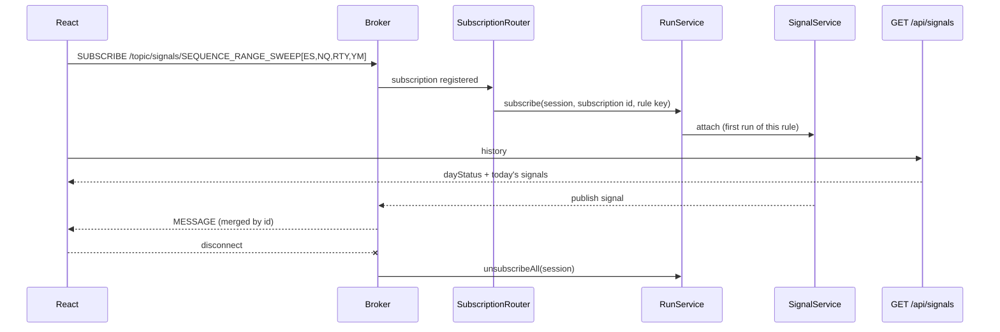

# Signals and UI

Part of [[00_architecture_overview]]. Results come from aggregate rules ([[04_rule_model]]); users attach through [[05_rule_lifecycle]]. Live bars for charts: [[10_live_bars]].

## SignalService

Listens to aggregate results and decides what reaches users. It holds one subscription per aggregate, whatever the number of users, gives each signal an increasing `id`, and keeps the current trading day's signals for the history call.

| `RuleResult` kind | Iteration 1 |
|-------------------|-------------|
| `REPORT` | Forwarded as a report for the instrument in `scope`, e.g. `RANGE_SWEEP_EVENT` (the rule fired for it), `RANGE_SWEEP_NO_EVENT` (it was checked after a break and did not qualify) or `EXTREMITY_PASSED` (a break, with or without events) |
| `STATUS` | Forwarded as a status, e.g. `INVALID_WINDOW` (no events possible today) |

The decision lives here, not in the rule, so it can later filter or combine results (e.g. only signal when several rules agree) without touching any rule.

Wording stays factual, never directive (see the README's legal section):

```json
{
  "id": 2,
  "ruleKey": "SEQUENCE_RANGE_SWEEP[ES,NQ,RTY,YM]",
  "rule": "SEQUENCE_RANGE_SWEEP",
  "kind": "REPORT",
  "code": "RANGE_SWEEP_EVENT",
  "level": "L3_22_5M",
  "scope": ["ES"],
  "eventTime": "2026-10-12T14:12:40Z",
  "evidence": {
    "trigger": { "symbol": "YM", "side": "LOW", "price": 44168.00 },
    "target":  { "barTime": "2026-10-12T14:12:40Z", "low": 6027.00, "H": 6032.00, "L": 6026.00, "M": 6029.00 }
  }
}
```

## Transport: WebSocket with STOMP

| Option | Outcome |
|--------|---------|
| ZeroMQ to the browser | Not possible: browsers cannot open raw TCP sockets |
| gRPC | Browsers need gRPC-Web plus a translating proxy (Envoy) or a gRPC-Web capable server (Armeria). Rejected for now. |
| SSE | Rejected: not wanted to build and maintain |
| **WebSocket with STOMP** | **Chosen**: Spring `spring-boot-starter-websocket` on the service, `@stomp/stompjs` in React |

Spring starts with an in-memory broker and can switch to an external broker (RabbitMQ, ActiveMQ) with a configuration change. That is the "message broker later" path.

### How it works

**One WebSocket per client** (browser tab), at `ws://127.0.0.1:8080/ws`. That connection is the client's STOMP session; all its subscriptions share it. There is no shared socket: the broker inside the service keeps a table topic → subscribed sessions and writes a copy of each published message into every subscribed session's socket.

```
 React tab A ══ WebSocket A ══╗                         ┌──────────────────────────────┐
   /topic/signals/SRS         ║                         │ broker table                 │
   /topic/bars/ES             ╠══► Spring /ws ──► broker │  /topic/signals/SRS → A, B   │
 React tab B ══ WebSocket B ══╝                         │  /topic/bars/ES     → A      │
   /topic/signals/SRS                                   │  /topic/bars/NQ     → B      │
   /topic/bars/NQ                                       └──────────────────────────────┘
```

STOMP is a small text protocol inside the WebSocket, one frame per WebSocket message:

```
SUBSCRIBE                        ← client
id:sub-0
destination:/topic/signals/SEQUENCE_RANGE_SWEEP[ES,NQ,RTY,YM]

MESSAGE                          ← service, for that subscription
subscription:sub-0
destination:/topic/signals/SEQUENCE_RANGE_SWEEP[ES,NQ,RTY,YM]
{"id":2,"kind":"REPORT","code":"RANGE_SWEEP_EVENT","scope":["ES"],...}
```

### Subscribing is the only command

Clients only subscribe and unsubscribe. A subscription to one of the two topic families starts what it names; the last subscription leaving stops it:

| Client | Service |
|--------|---------|
| SUBSCRIBE `/topic/signals/{ruleKey}` | Start the rule, or join it ([[05_rule_lifecycle]]) |
| SUBSCRIBE `/topic/bars/{symbol}` | Start the symbol's bar feed, or join it ([[10_live_bars]]) |
| UNSUBSCRIBE | Leave; the last one out tears the rule or feed down |
| Disconnect (closed tab, or heartbeats missed for `alert.api.heartbeat`) | Leave everything the session held |
| SUBSCRIBE to any other destination | Ignored: not ours |

`SubscriptionRouter` does this. It runs **after** the broker has handled the SUBSCRIBE frame, so the subscription is already registered when the rule or feed starts, and an error published on the topic reaches the client. Frames of one session are handled in the order sent, and messages reach a session in the order they were published.

**Rule keys must be canonical**: the type, then the symbols sorted and unique, e.g. `SEQUENCE_RANGE_SWEEP[ES,NQ,RTY,YM]`. The service publishes to the canonical topic, so a client subscribed to `…[YM,ES,NQ,RTY]` would wait on a topic nobody uses; such a subscription gets an error naming the canonical key.

### Errors arrive on the subscribed topic

| Topic | Invalid when |
|-------|--------------|
| `/topic/bars/{symbol}` | The symbol is not 1-16 uppercase letters or digits |
| `/topic/signals/{ruleKey}` | Malformed key, unknown rule type, invalid symbol, too few symbols, or not canonical |

A well-formed symbol the adapters never publish (e.g. `ZZ`) is not an error: the service cannot know which symbols the adapters carry, so the feed opens and stays quiet. A failure while starting a valid subscription is reported the same way, with code `INTERNAL_ERROR`.

Every session subscribed to that exact topic receives the error, which is right: they all asked for the same thing.

### Messages on a signal topic

`kind` tells them apart:

| `kind` | Meaning | `code` |
|--------|---------|--------|
| `REPORT` | A fact worth showing about the instrument in `scope` | `RANGE_SWEEP_EVENT`, `RANGE_SWEEP_NO_EVENT`, `EXTREMITY_PASSED` |
| `STATUS` | The rule cannot produce events today | `INVALID_WINDOW` |
| `ERROR` | The subscription is invalid, or starting it failed; text in `message` | `INVALID_SUBSCRIPTION`, `INTERNAL_ERROR` |

```json
{ "ruleKey": "SEQUENCE_RANGE_SWEEP[YM,ES]", "kind": "ERROR", "code": "INVALID_SUBSCRIPTION",
  "message": "Rule key 'SEQUENCE_RANGE_SWEEP[YM,ES]' is not in canonical form (symbols sorted and unique): use SEQUENCE_RANGE_SWEEP[ES,YM]" }
```

Fields without a value are left out of the JSON.

## Reset: start the day over

`POST /api/reset` (`Content-Type: application/json`, any JSON body, answer `204`) drops the stored bars ([[10_live_bars]]) and the signal history, and replaces the instances of every running rule with fresh ones, so the next bars are judged from a blank slate (day status `UNKNOWN`). The rules keep running for their users and signal ids keep counting up. Another content type is refused (`415`), which also makes a browser send a CORS preflight, so only the allowed origins can call it. It is meant for trying scenarios one after the other without restarting the service.

## History: what was emitted before the client subscribed

`GET /api/signals/{ruleKey}` (URL-encode the key) returns the day status and the current trading day's signals of a running rule; 404 if nobody runs it.

```json
{ "ruleKey": "SEQUENCE_RANGE_SWEEP[ES,NQ,RTY,YM]", "dayStatus": "VALID", "tradingDay": "2026-10-12",
  "signals": [ { "id": 1, "kind": "REPORT", ... }, { "id": 2, "kind": "REPORT", "code": "RANGE_SWEEP_EVENT", ... } ] }
```

`dayStatus` is `UNKNOWN` (not judged yet today; judged when 3-3-4 starts), `VALID` or `INVALID_WINDOW`. The history lives as long as the rule instance: when the last subscriber leaves, the instance and its history are dropped.

A client that subscribes first and then calls the history endpoint misses nothing: it merges both and drops duplicates by `id`.



## Session end

When a session ends, Spring publishes a `SessionDisconnectEvent`; `SessionEvents` releases the session's rule runs and bar feeds, which may cascade down to closing providers ([[05_rule_lifecycle]]). A reconnecting UI simply subscribes again; instances are shared, so it reattaches to the running ones.

## Security

`spring-boot-starter-security` is removed for iteration 1: this is a local desktop app with no user accounts. Because nothing is authenticated, the HTTP/WebSocket server listens on **localhost only** (`server.address=127.0.0.1`), so no other machine can reach it. The history endpoints allow cross-origin `GET` from the configured local origins (the React dev server). Revisit if the service ever runs on another machine than the UI.
