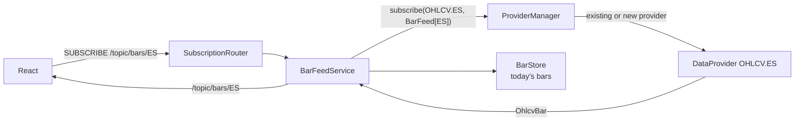

# Live Bars

Part of [[00_architecture_overview]]. Transport: [[07_signals_and_ui]]. Providers: [[02_market_data_ingestion]].

Charts show the live 1-second bars of a symbol and highlight the signals of a rule on them. The client aggregates bars into whatever timeframe each view shows; the service sends plain 1-second bars, no aggregation.

## Feed



- A bar feed is a consumer of `ProviderManager` like a basic rule: if a rule already reads ES it shares that provider, otherwise `ProviderManager` creates one. Bar feeds and rules know nothing about each other.
- One provider subscription per symbol, whatever the number of watchers. Watchers are the client subscriptions to `/topic/bars/{symbol}`; the last one leaving closes the feed, and the provider closes if nothing else uses it.
- Bars are handled on the provider's thread: published, then stored.

## Messages on a bar topic

```json
{ "type": "BAR", "symbol": "ES", "time": "2026-10-12T14:12:40Z",
  "open": 6027.00, "high": 6028.00, "low": 6027.00, "close": 6028.00, "volume": 12 }
{ "type": "ERROR", "message": "Invalid symbol: es" }
```

`time` is the bar start (UTC); the bar covers `[time, time + 1 s)`.

## History: today's bars

`GET /api/bars/{symbol}?from=2026-10-12T13:45:00Z` returns the stored bars of the current trading day, from `from` (inclusive, optional):

```json
{ "symbol": "ES", "tradingDay": "2026-10-12", "bars": [ { "type": "BAR", "time": "...", ... } ] }
```

`BarStore` keeps them:

| Item | Value |
|------|-------|
| Kept | The current trading day per symbol; dropped when the symbol's first bar of the next trading day arrives (18:00 New York) |
| Covers | Only bars received while a bar feed for the symbol was open: the service never fetches history, and bars read only by rules are not stored. So the history covers "since the first watcher of the day" |
| Layout | Parallel `long` arrays: start, open, high, low, close, volume. Prices as whole numbers scaled by 10^6 |
| Size | 48 bytes per bar; a full day (86,400 bars) is about 4 MB per symbol, about 17 MB for four. As `OhlcvBar` objects it would be about 220 bytes per bar |
| Not stored | A bar not newer than the last stored one, or with a price of more than 6 decimals (logged). It is still published live |
| Response size | About 8 MB of JSON for a full day of one symbol; use `from` to fetch only what is missing |

## On the client

1. Subscribe to `/topic/bars/{symbol}` and `/topic/signals/{ruleKey}`; buffer what arrives.
2. Call `GET /api/bars/{symbol}` and `GET /api/signals/{ruleKey}`.
3. Merge: bars by `time`, signals by `id`, dropping duplicates.

Highlighting a signal needs only the signal itself:

| Chart element | From the signal |
|---------------|-----------------|
| Marker position | `eventTime` (the trigger second) on the instrument in `scope` |
| Marker style | One neutral marker for every `RANGE_SWEEP_EVENT`, whatever the side |
| Trigger break | `REPORT` `EXTREMITY_PASSED`: `scope` is the instrument that broke, `evidence.price` and `evidence.level` |
| 3-3-3 range lines | `evidence.target.H`, `L`, `M` of a `RANGE_SWEEP_EVENT` |
| Day banner | `STATUS` `INVALID_WINDOW`, or `dayStatus` from the history call |

Bars only go to the local UI, through a server listening on localhost, so the service still does not redistribute market data (README).
