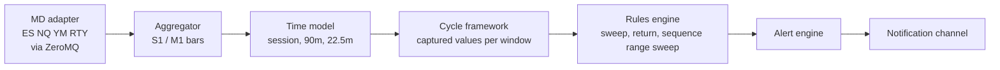
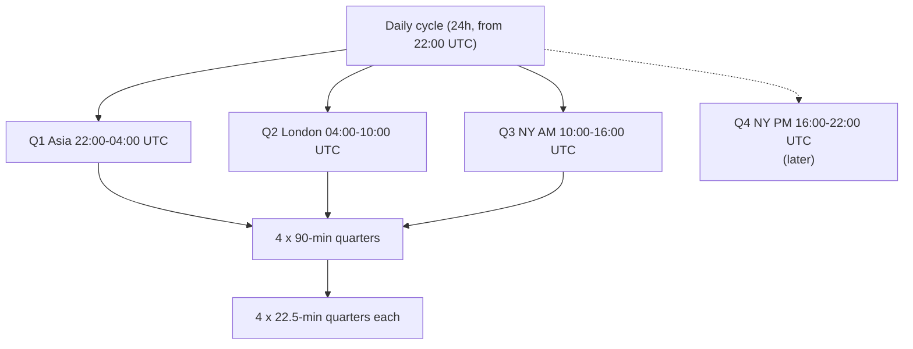

# Implementation Strategy: Overview

Concrete scope of what this project implements from [[strategy_philosophy]].

## The idea: a rules engine on top of the quarterly theory

The **framework** is the quarterly theory: a fixed UTC time grid (6h, 90-min, 22.5-min windows) and the values captured in it ([[03_cycle_lifecycle]]). On top of it the service runs independent **rules**, each a separate time-based criterion, one file each in the `rules` folder. When several rules agree, the evidence is stronger.

| Rule | Note |
|------|------|
| Sweep | [[sweep]] |
| Return confirmation | [[return_confirmation]] |
| Sequence range sweep | [[sequence_range_sweep]] |

How rules are combined: [[00_rules_engine]].

## Scope (phase 1)

| Item | Decision |
|------|----------|
| Instruments | ES, NQ, YM, RTY (CME equity index futures) |
| Daily quarters handled | Q1 Asia, Q2 London, Q3 NY AM |
| Daily quarter Q4 (NY PM) | Added later |
| Subdivisions | 6-hour session → 90-min → 22.5-min |
| Time | **UTC only**; fixed grid anchored at 22:00 UTC, every day is exactly 24 h |
| Output | Alerts (see [[05_alerts_and_open_questions]]) |

## Reading order

1. [[01_instruments_and_data]] - what we watch and what data we need
2. [[02_time_model]] - sessions and how they are subdivided
3. [[03_cycle_lifecycle]] - the framework: windows, captured values, nesting
4. [[04_ssmt]] - cross-instrument divergence
5. [[05_alerts_and_open_questions]] - what gets emitted, and what is still undecided
6. [[06_market_data_contract]] - ZeroMQ input, bar granularity, approximation policy
7. [[00_rules_engine]] - the rules engine, and the `rules` folder with one file per criterion

## High-level flow

## Fractal levels in scope

Each session is itself a full 4-quarter cycle (90-min quarters), and each 90-min quarter is a full cycle (22.5-min quarters).
