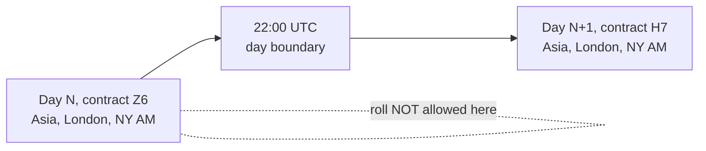

# Instruments and Data

Part of [[00_overview]].

## Instruments

| Symbol | Index | Contract |
|--------|-------|----------|
| ES | S&P 500 | E-mini S&P 500 |
| NQ | Nasdaq-100 | E-mini Nasdaq-100 |
| YM | Dow Jones | E-mini Dow |
| RTY | Russell 2000 | E-mini Russell 2000 |

They are highly correlated, which is what makes [[04_ssmt]] meaningful: when one makes a new extreme and another does not, that disagreement is the signal.

## Data: received, not requested

The service does not fetch data. It listens to a ZeroMQ connection and receives bar events from a user-written market data adapter. Full contract, granularity handling and rounding policy are in [[06_market_data_contract]].

Short version:
- Every event declares its **granularity** (`S1` or `M1` initially).
- With `S1` all levels are exact. With `M1` the 22.5-min level is approximate (a quarter is 22 min 30 s), so the service warns and applies a user-chosen rounding policy.

## Data we keep per instrument, per quarter

- `open`, `high`, `low`, `close`
- `highTime`, `lowTime` (when the extreme was made, needed for SSMT ordering)
- quarter start and end timestamps

## Open items

- ~~Contract roll~~: decided, the adapter handles it (see below)
- Historical replay for testing: an adapter that replays a file onto the same ZeroMQ socket

## Contract roll

ES, NQ, YM and RTY are futures that expire quarterly (March, June, September, December). Each expiry has its own contract (e.g. `ESZ6`, `ESH7`). Near expiry, traders and volume move to the next contract. That switch is the **roll**.

Why it matters here: the algorithm compares prices against earlier highs and lows (Q1 range, previous quarter extremes). Two contracts trade at slightly different prices (the spread, or basis). If the feed switches from the old to the new contract in the middle of a cycle, a price jump appears that is not a real move. It could look like a false sweep or break a range.

### What providers do

| Provider | Roll handling |
|----------|---------------|
| Databento | Offers continuous symbols `ROOT.RULE.RANK`, e.g. `ES.v.0`. Rules: `c` calendar (by expiration), `n` open interest (ranked on the previous day's close), `v` volume (ranked on the previous day's volume). Rank `0` is the front contract. Prices are the **original, unadjusted** prices of the underlying contract; there is no back-adjustment, so a jump at the roll is possible. |
| Massive (ex-Polygon) | Exposes individual contracts only (e.g. `ESU6`, `ESZ6`) with specs such as first/last trade date. The docs I found describe **no continuous series and no roll logic**; the caller picks and switches contracts. |

Not verified: the exact moment of day at which Databento's continuous symbols switch contract (I could not load that page). If it switches at a calendar-date boundary such as UTC midnight, that would fall in the middle of the Asia session (00:00 UTC falls 2 hours into Asia Q1), which is exactly what we want to avoid. Check before relying on it.

### Rule for this project

**Decision: the MD adapter handles rolling.** The service has no roll logic and never sees contract months; it only receives one continuous series per symbol (`ES`, `NQ`, `YM`, `RTY`). The rest of this section is the rule the adapter is expected to follow.

A trading day starts at 22:00 UTC and contains all of our sessions (Asia, London, NY AM, later NY PM). So "no roll mid session" is extended to **no roll mid trading day**:

- The contract is switched **only at the 22:00 UTC boundary**, i.e. when a new trading day (and a new Asia Q1) begins.
- Every cycle of a trading day is therefore computed from a single contract and never mixes prices of two contracts.
- When the roll happens is decided by the adapter (calendar, volume or open interest are all valid). The service only requires that the switch lands on a trading-day boundary.

Consequence: a provider-side continuous symbol is only usable if it switches at 22:00 UTC. Otherwise the adapter must request explicit contracts (as Massive requires) and apply the roll itself.

Sources: [Databento symbology](https://databento.com/docs/standards-and-conventions/symbology), [Databento continuous contracts](https://databento.com/docs/examples/symbology/continuous), [Massive futures announcement](https://www.massive.com/blog/futures-data-has-arrived).
