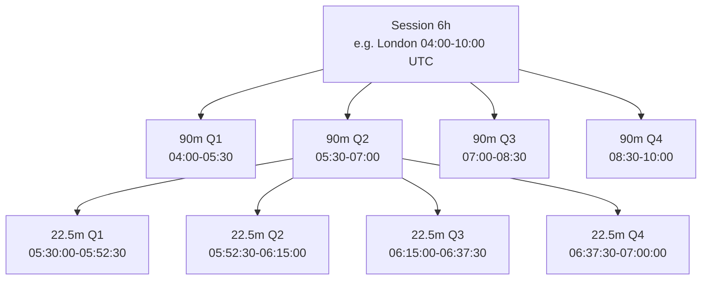
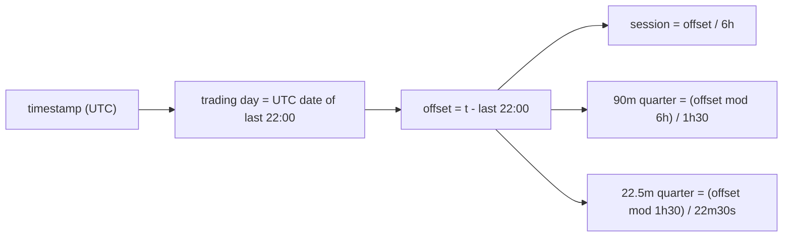

# Time Model

Part of [[00_overview]]. Defines every time window the service reasons about.

**All times in this project are UTC. Never New York time, never any other local time, no daylight saving.**

## Why a fixed anchor

The service runs continuously and listens to ZeroMQ; it has no start time and does not care when it was launched. But to say "this bar belongs to Q2 London" the service needs a fixed reference for where the 24-hour grid begins. The anchor is that grid line, like the 12 on a clock face: it does not depend on when you look at the clock.

The anchor is **22:00 UTC**. Everything else is derived from it by repeated division by 4.

## Daily quarters (sessions)

The trading day starts at **22:00 UTC** and runs exactly 24 h. Every day has the same length, since UTC has no daylight saving.

| Daily quarter | Label | Start (UTC) | End (UTC) | In scope |
|---------------|-------|-------------|-----------|----------|
| Q1 | Asia | 22:00 | 04:00 | Yes |
| Q2 | London | 04:00 | 10:00 | Yes |
| Q3 | NY AM | 10:00 | 16:00 | Yes |
| Q4 | NY PM | 16:00 | 22:00 | Later |

The names are only labels for the four 6-hour quarters. They carry no timezone meaning in the code.

```mermaid
gantt
    title Daily cycle (UTC)
    dateFormat HH:mm
    axisFormat %H:%M
    section Daily quarters
    Q1 Asia       :a1, 22:00, 6h
    Q2 London     :a2, after a1, 6h
    Q3 NY AM      :a3, after a2, 6h
    Q4 NY PM (later) :crit, a4, after a3, 6h
```

## Subdivision of a session

Every session (6h) is split the same way:

| Level | Length | Count per parent |
|-------|--------|------------------|
| Session | 6 h | - |
| 90-min quarter | 1 h 30 min | 4 per session |
| 22.5-min quarter | 22 min 30 s | 4 per 90-min, 16 per session |

## Full timetable of the three sessions (UTC)

90-min quarters (each one has four 22.5-min quarters inside):

| Session | 90m Q1 | 90m Q2 | 90m Q3 | 90m Q4 |
|---------|--------|--------|--------|--------|
| Asia | 22:00-23:30 | 23:30-01:00 | 01:00-02:30 | 02:30-04:00 |
| London | 04:00-05:30 | 05:30-07:00 | 07:00-08:30 | 08:30-10:00 |
| NY AM | 10:00-11:30 | 11:30-13:00 | 13:00-14:30 | 14:30-16:00 |

22.5-min offsets inside any 90-min quarter: `+0:00`, `+22:30`, `+45:00`, `+67:30`.

## Rules for the implementation

- **All windows are computed in UTC from the 22:00 UTC grid line.** No timezone conversion anywhere. The input `startTime` is already UTC (see [[06_market_data_contract]]).
- Windows are **half-open**: `[start, end)`. A bar starting at exactly `10:00:00` belongs to NY AM, not London.
- Any timestamp maps to exactly one window per level: `(session, 90m quarter, 22.5m quarter)`.
- Sessions cross the UTC date boundary (Asia starts on day D at 22:00 and ends on D+1 at 04:00), so a "trading day" is keyed by the **UTC date of its 22:00 start**.
- Every trading day is exactly 24 h. There are no 23 h or 25 h days.

## Consequence of a fixed UTC grid

The grid never moves, but real market events do: the exchange's daily open and break, and the London and New York opens, shift by one hour in UTC between summer and winter. So during half of the year the real Asia open will arrive at 23:00 UTC instead of 22:00 UTC, and the first hour of Q1 Asia will simply contain no bars. The model treats missing bars as normal (see [[06_market_data_contract]]), so this is acceptable, but it means session labels are approximate relative to real-world sessions.

## Block address (base 4)

A day contains 64 blocks of 22.5 min. Each block is addressed by three base-4 digits (6h quarter, 90-min quarter, 22.5-min quarter), each 0-3 for Q1-Q4. Block number = 16 x d1 + 4 x d2 + d3.

| Address | Block | Time (UTC) |
|---------|-------|------------|
| 0,0,0 | 0 | 22:00:00 |
| 2,2,2 | 42 | 13:45:00 |
| 2,2,3 | 43 | 14:07:30 |
| 2,3,0 | 44 | 14:30:00 |

Used by [[sequence_range_sweep]].

## Mapping function (conceptual)

