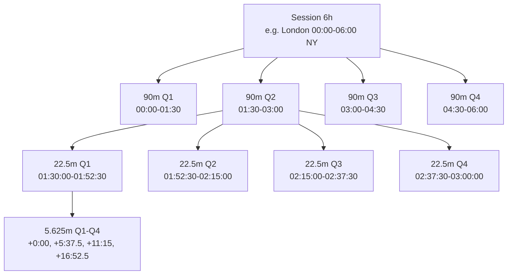
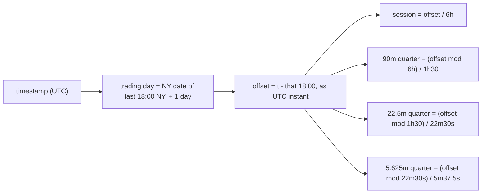

# Time Model

Part of [[00_overview]]. Defines every time window the service reasons about. Implementation: [[01_time_grid]].

**Timestamps are UTC, in and out.** The grid itself is anchored to the market open in New York time, so its windows move by one hour in UTC when the US changes clocks.

## Why an anchor

The service runs continuously and listens to ZeroMQ; it has no start time and does not care when it was launched. But to say "this bar belongs to Q2 London" the service needs a fixed reference for where the 24-hour grid begins. The anchor is that grid line, like the 12 on a clock face: it does not depend on when you look at the clock.

The anchor is **18:00 New York time** (`America/New_York`), the CME Globex open for ES, NQ, YM and RTY. Everything else is derived from it by repeated division by 4.

| Period | US clock | Anchor in UTC |
|--------|----------|---------------|
| 2nd Sunday of March to 1st Sunday of November | EDT (UTC-4) | 22:00 UTC |
| Rest of the year | EST (UTC-5) | 23:00 UTC |

## Daily quarters (sessions)

The trading day starts at **18:00 New York** and runs exactly 24 h. US clocks change on a Sunday at 02:00, inside the weekend gap (Friday 17:00 close to Sunday 18:00 open), so no trading day ever contains a clock change.

| Daily quarter | Label | NY time | UTC (EDT) | UTC (EST) | In scope |
|---------------|-------|---------|-----------|-----------|----------|
| Q1 | Asia | 18:00-00:00 | 22:00-04:00 | 23:00-05:00 | Yes |
| Q2 | London | 00:00-06:00 | 04:00-10:00 | 05:00-11:00 | Yes |
| Q3 | NY AM | 06:00-12:00 | 10:00-16:00 | 11:00-17:00 | Yes |
| Q4 | NY PM | 12:00-18:00 | 16:00-22:00 | 17:00-23:00 | Later |

The names are only labels for the four 6-hour quarters. The CME daily halt (17:00-18:00 NY) always falls in the last hour of Q4.

```mermaid
gantt
    title Daily cycle (New York time)
    dateFormat HH:mm
    axisFormat %H:%M
    section Daily quarters
    Q1 Asia       :a1, 18:00, 6h
    Q2 London     :a2, after a1, 6h
    Q3 NY AM      :a3, after a2, 6h
    Q4 NY PM (later) :crit, a4, after a3, 6h
```

## Subdivision of a session

Every session (6h) is split the same way:

| Level | Length | Count per parent |
|-------|--------|------------------|
| Session | 6 h | - |
| 90-min quarter | 1 h 30 min | 4 per session |
| 22.5-min quarter | 22 min 30 s | 4 per 90-min, 16 per session |
| 5.625-min quarter | 5 min 37.5 s | 4 per 22.5-min, 64 per session |

## Full timetable of the three sessions (New York time)

90-min quarters (each one has four 22.5-min quarters inside):

| Session | 90m Q1 | 90m Q2 | 90m Q3 | 90m Q4 |
|---------|--------|--------|--------|--------|
| Asia | 18:00-19:30 | 19:30-21:00 | 21:00-22:30 | 22:30-00:00 |
| London | 00:00-01:30 | 01:30-03:00 | 03:00-04:30 | 04:30-06:00 |
| NY AM | 06:00-07:30 | 07:30-09:00 | 09:00-10:30 | 10:30-12:00 |

22.5-min offsets inside any 90-min quarter: `+0:00`, `+22:30`, `+45:00`, `+67:30`. 5.625-min offsets inside any 22.5-min quarter: `+0:00`, `+5:37.5`, `+11:15`, `+16:52.5`.

UTC = NY + 4 h during EDT, NY + 5 h during EST.

## Rules for the implementation

- **The input `startTime` is UTC** (see [[06_market_data_contract]]). The time zone is only used to find the UTC instant of the 18:00 New York start of the trading day; everything inside the day is a plain offset from it.
- Windows are **half-open**: `[start, end)`. A bar starting at exactly `06:00:00` NY belongs to NY AM, not London.
- **A bar belongs to the window containing its start time.** With 1-second bars this is exact down to the 22.5-min level. The 5.625-min level has boundaries on half seconds; a bar straddling one belongs to the earlier window, so in effect the boundary moves up to the next whole second (quarters of 338, 337, 338, 337 bars, error at most 0.5 s).
- Any timestamp maps to exactly one window per level: `(session, 90m quarter, 22.5m quarter, 5.625m quarter)`.
- Sessions cross the date boundary (Asia starts on day D at 18:00 NY and ends on D+1 at 00:00 NY), so a "trading day" is keyed by its **CME trade date**: the New York date on which it ends (its 18:00 start date + 1 day). The session opening Sunday 18:00 is Monday's trading day.
- Every trading day is exactly 24 h. There are no 23 h or 25 h days.

## Consequence of anchoring to New York

The grid follows the US market all year: 3-3-3 is always 09:45 NY, 15 minutes after the cash open, and the daily halt always sits at the end of NY PM. The cost is that other markets drift against it when their clocks change on different dates: the UK changes on the last Sundays of March and October, so the real London open (08:00 UK) moves one hour against the grid for about four weeks a year. Session names are labels, so this is accepted.

## Block address (base 4)

A day contains 64 blocks of 22.5 min, or 256 blocks of 5.625 min. Each block is addressed by base-4 digits (6h quarter, 90-min quarter, 22.5-min quarter, and optionally 5.625-min quarter), each 0-3 for Q1-Q4. 22.5-min block number = 16 x d1 + 4 x d2 + d3; 5.625-min block number = 64 x d1 + 16 x d2 + 4 x d3 + d4.

| Address | 22.5m block | NY time | UTC (EDT) | UTC (EST) |
|---------|-------------|---------|-----------|-----------|
| 0,0,0 | 0 | 18:00:00 | 22:00:00 | 23:00:00 |
| 2,2,2 | 42 | 09:45:00 | 13:45:00 | 14:45:00 |
| 2,2,3 | 43 | 10:07:30 | 14:07:30 | 15:07:30 |

Used by [[sequence_range_sweep]].

## Mapping function (conceptual)

