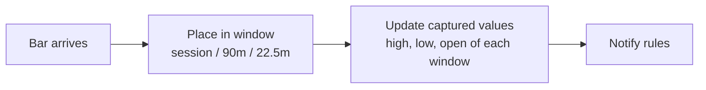
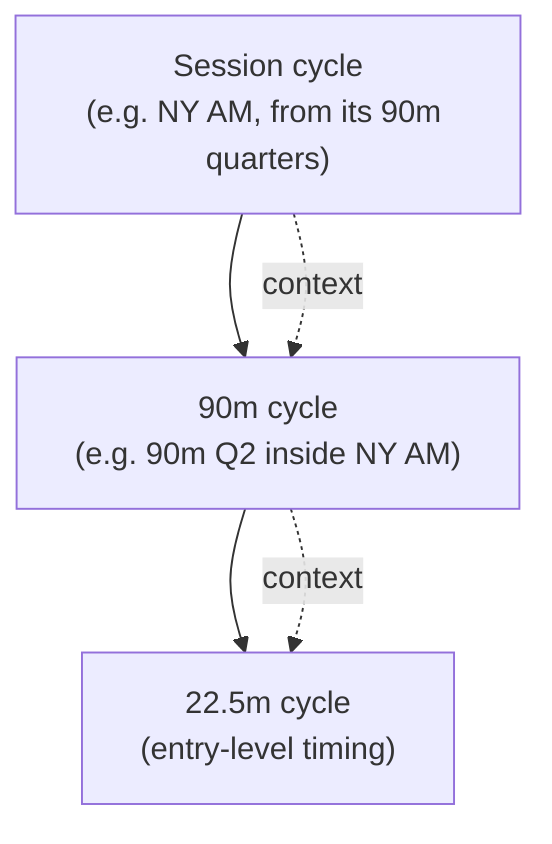
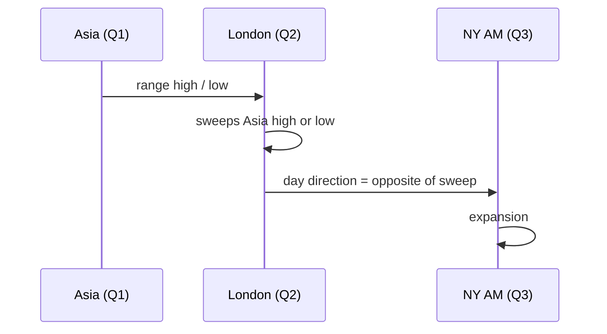

# Cycle Framework

Part of [[00_overview]]. This note describes the quarterly-theory framework the service runs: which windows exist, what values are captured in them, and how levels nest. The criteria that read these values live in [[00_rules_engine]] (one file per rule in the `rules` folder).

Time model: [[02_time_model]]. Theory: [[strategy_philosophy]].

## What is a "cycle" here

A cycle is any window that has four quarters: a **session** (quarters = 90m) or a **90-min quarter** (quarters = 22.5m). The same logic runs on both levels, **independently per instrument**.

The daily cycle's own quarters are the sessions themselves. At the daily level there is no "previous session" inside the same day for Q1 Asia, so the daily level is mostly **context** (see below).

## Values the framework captures

The framework only captures numbers. Rules decide what they mean.

| Value | Captured when | Used by |
|-------|---------------|---------|
| `q1High`, `q1Low`, `q1Open` | During and at end of Q1 of a cycle | [[sweep]], [[return_confirmation]] |
| `trueOpen` (first price of Q2) | Start of Q2 | [[return_confirmation]] |
| Bars of Q2, as they arrive | During Q2 | [[sweep]], [[return_confirmation]] |
| High, low and mean (`H`, `L`, `M`) of a given 22.5-min block | During the block | [[sequence_range_sweep]] |

## Nesting: levels reinforce each other

Cycles are nested, and a lower-level result is stronger when it agrees with the level above it.

Example: a bullish result on a 90-min cycle that lies inside a NY AM session which is also bullish is higher confidence than the same result against the session's direction. How levels are prioritised is an open question in [[00_rules_engine]].

## Cross-session context (UTC)

| Session | UTC | Context it carries |
|---------|-----|--------------------|
| Asia (Q1) | 22:00-04:00 | Its high/low become the day's first range |
| London (Q2) | 04:00-10:00 | Expected to take out Asia's high or low |
| NY AM (Q3) | 10:00-16:00 | Expected to move opposite to London's sweep |

The sweep, return and bias logic that used to be described here is now in [[sweep]] and [[return_confirmation]].
