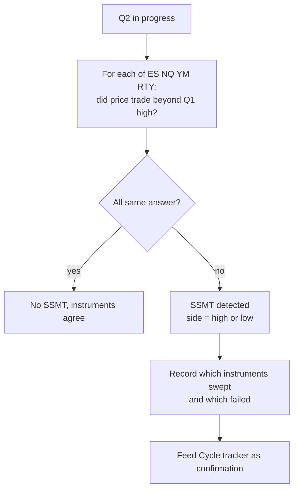
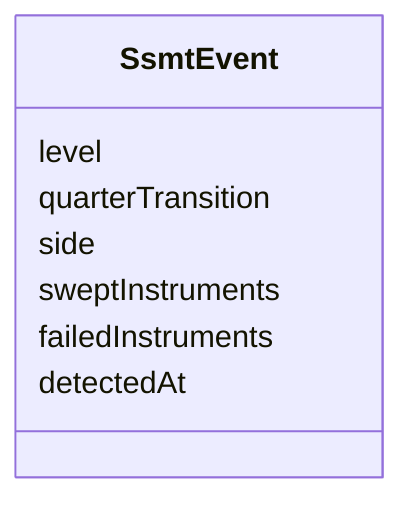

# SSMT (Sequential SMT Divergence)

Part of [[00_overview]]. Concept explained in [[strategy_philosophy]]; instruments in [[01_instruments_and_data]].

> SSMT is a cross-instrument comparison built on the sweep rule ([[sweep]]). It is a candidate to become its own rule in [[00_rules_engine]].

## Definition used in this project

For a given quarter boundary, compare the four instruments (ES, NQ, YM, RTY) on whether they **took the previous quarter's extreme**.

- **Bearish SSMT**: some instruments take the previous quarter's **high**, others fail to.
- **Bullish SSMT**: some instruments take the previous quarter's **low**, others fail to.

The instrument that fails to confirm shows relative strength (bearish case: weakness is revealed; bullish case: strength is revealed). The signal is confirmation that a sweep was a manipulation, not a real breakout.

## Example

Q1 highs vs Q2 behavior:

| Instrument | Swept Q1 high in Q2? |
|------------|----------------------|
| ES | Yes |
| NQ | Yes |
| YM | **No** |
| RTY | Yes |

YM failed to confirm, so this is a bearish SSMT on the Q1 → Q2 transition.

## Where it applies

SSMT is evaluated at **each level** that has a tracked cycle:

| Level | Compares |
|-------|----------|
| Session | Asia high/low vs London (and London vs NY AM) |
| 90-min | 90m Q1 vs 90m Q2, etc. |
| 22.5-min | 22.5m Q1 vs 22.5m Q2, etc. |

## Timing detail

Order matters ("sequential"): the key piece of information is **who made the extreme first and who failed**. That is why [[01_instruments_and_data]] stores `highTime` and `lowTime`.

## Output

An SSMT event contains: level, quarter transition, side (high/low), the swept set, the failed set, and the timestamp of detection.

## Open items

- Is a 3-vs-1 split enough, or do we require 2-vs-2 as well?
- Does a failed instrument need to miss by any amount, or by a minimum number of ticks?
- Detect at the moment of divergence, or only once the quarter closes?
