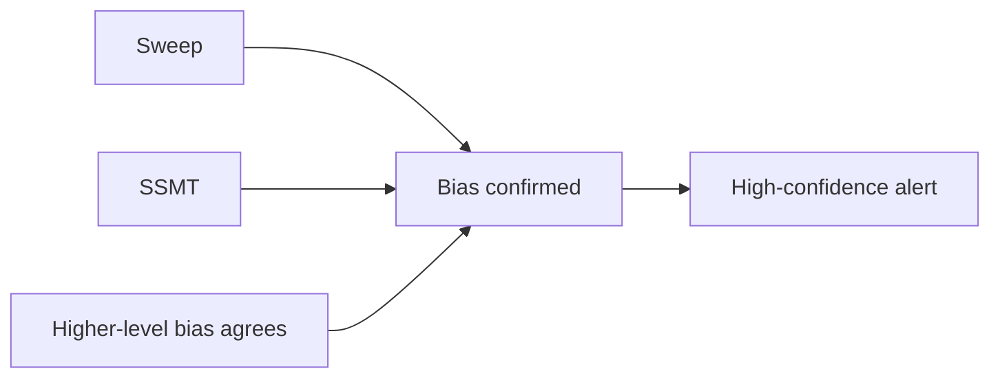
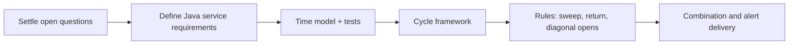

# Alerts and Open Questions

Part of [[00_overview]].

## Candidate alert types

| Alert | Trigger | Source |
|-------|---------|--------|
| Quarter start | A session / 90m / 22.5m window begins | [[02_time_model]] |
| True open set | First price of a Q2 | [[03_cycle_lifecycle]] (captured value) |
| Sweep detected | Q2 trades beyond Q1 high/low | [[sweep]] |
| Bias confirmed | Sweep followed by return | [[return_confirmation]] |
| Diagonal divergence | Outlier among the 4 instruments at 13:45:00 UTC (always sent) | [[diagonal_opens]] stage 1 |
| Failure swing (BUY / SHORT) | 3-3-3 high/low broken in 3-3-4, then in 3-4-1 a 1s bar passes an extremity and closes on the matching side of the 3-3-3 mean (14:30:00-14:52:30 UTC) | [[diagonal_opens]] stage 2 |
| SSMT detected | Instruments disagree on a sweep | [[04_ssmt]] |
| High-confidence setup | Bias confirmed + SSMT + agrees with higher level | combined |

## Open questions

### Data
Decided (see [[06_market_data_contract]]):
- ~~Provider and tick vs bars~~: the service only listens on ZeroMQ; adapters own provider access.
- ~~Granularity~~: each event declares it (`S1`/`M1`); the service aggregates, warns on approximate levels, and lets the user pick a rounding policy for 22.5 min with `M1`.
- ~~Wire format, bar updates, ALTERNATE option~~: JSON, completed bars only (a received bar is final), `ALTERNATE` (22, 23, 22, 23) included alongside `FLOOR` and `CEIL`.
- ~~Contract roll~~: handled by the MD adapter, which must switch contracts only at the 22:00 UTC trading-day boundary (see [[01_instruments_and_data]]).

Deferred:
- ZeroMQ topology: implementation phase.
- Late/duplicate/stale bars: not handled for now.
- Backtest error measurement: separate system docs. These notes describe the algorithm and the planned system, not implementation details.

### Rules
Each criterion now has its own file in the `rules` folder with its own open questions. Framework and combination questions are in [[00_rules_engine]].
- [[sweep]]: wick vs close, minimum distance, both sides swept.
- [[return_confirmation]]: back across true open or inside Q1 range, validity window.
- [[diagonal_opens]]: outlier threshold and deviation measure (**deferred for now**); possible extension to lower intervals (90-min down to ~5-min), only noted.
- [[00_rules_engine]]: how results are combined, level priority.

### Time
- Holidays, early closes and the weekend gap (no bars from Friday evening until Sunday evening).
- Does the first session after the weekend gap behave as a normal Q1 Asia?
- Fixed UTC grid vs real session opens that shift by 1 h with daylight saving (see [[02_time_model]]): accepted for now?

### Output
- Where do alerts go (console, Telegram, Discord, email, webhook)?
- Persisted history of cycles and alerts?

## Next steps

Starting with the time model is recommended: it is deterministic, easy to unit test, and everything else depends on it.
