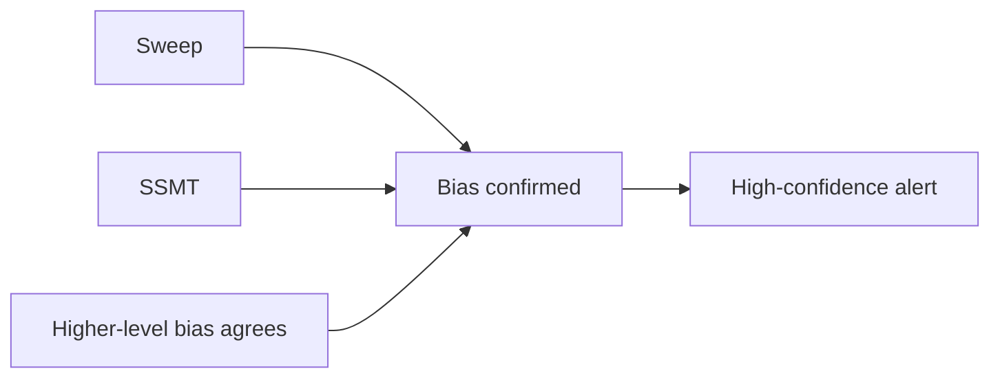
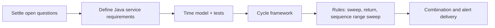

# Alerts and Open Questions

Part of [[00_overview]].

## Candidate alert types

| Alert | Trigger | Source |
|-------|---------|--------|
| Quarter start | A session / 90m / 22.5m window begins | [[02_time_model]] |
| True open set | First price of a Q2 | [[03_cycle_lifecycle]] (captured value) |
| Sweep detected | Q2 trades beyond Q1 high/low | [[sweep]] |
| Bias confirmed | Sweep followed by return | [[return_confirmation]] |
| Sequence range sweep (BUY / SHORT) | one instrument breaks its 3-3-3 high/low in 3-3-4 each other instrument whose low is in the lower half (low break) or high in the upper half (high break) of its own 3-3-3 range in the same second gets its own signal, sent right then during 3-3-4 (10:07:30-10:30:00 NY) | [[sequence_range_sweep]] |
| SSMT detected | Instruments disagree on a sweep | [[04_ssmt]] |
| High-confidence setup | Bias confirmed + SSMT + agrees with higher level | combined |

## Open questions

### Data
Decided (see [[06_market_data_contract]]):
- ~~Provider and tick vs bars~~: the service only listens on ZeroMQ; adapters own provider access.
- ~~Granularity~~: always 1-second bars, so no granularity field in the contract. The 5.625-min level uses a fixed half-second rule (see [[02_time_model]]).
- ~~Wire format, bar updates~~: JSON, completed bars only (a received bar is final), multipart `[topic, json]`.
- ~~Contract roll~~: handled by the MD adapter, which must switch contracts only at the 18:00 New York trading-day boundary (see [[01_instruments_and_data]]).

Deferred:
- ~~ZeroMQ topology~~: one SUB per topic `OHLCV.<SYMBOL>` (see [[02_market_data_ingestion]]).
- Late/duplicate/stale bars: not handled for now.
- Backtest error measurement: separate system docs. These notes describe the algorithm and the planned system, not implementation details.

### Rules
Each criterion now has its own file in the `rules` folder with its own open questions. Framework and combination questions are in [[00_rules_engine]].
- [[sweep]]: wick vs close, minimum distance, both sides swept.
- [[return_confirmation]]: back across true open or inside Q1 range, validity window.
- [[sequence_range_sweep]]: mean definition, entry price in the signal, handling several triggers; possible extension to lower intervals (90-min down to ~5-min), only noted.
- [[00_rules_engine]]: how results are combined, level priority.

### Time
- Holidays, early closes and the weekend gap (no bars from Friday evening until Sunday evening).
- Does the first session after the weekend gap behave as a normal Q1 Asia?
- ~~Fixed UTC grid vs real session opens~~: the grid is anchored at 18:00 New York and follows US daylight saving (see [[02_time_model]]).

### Output
- ~~Where do alerts go~~: a React UI over WebSocket for now (see [[07_signals_and_ui]]); other channels later.
- Persisted history of cycles and alerts?

## Next steps

Starting with the time model is recommended: it is deterministic, easy to unit test, and everything else depends on it.
