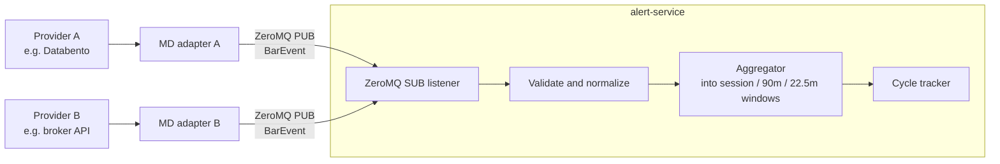
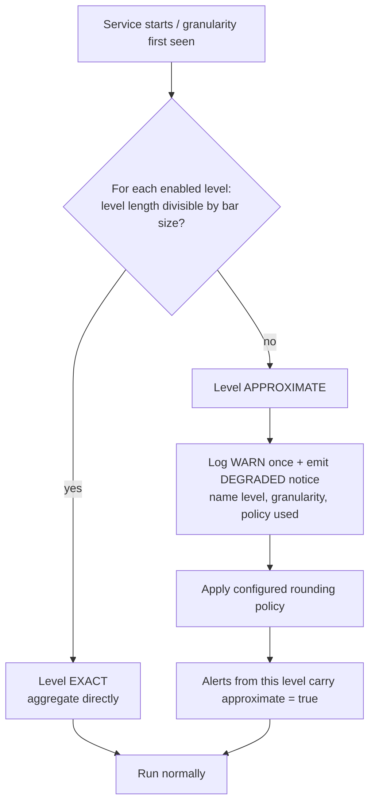

# Market Data Contract

Part of [[00_overview]]. Replaces the earlier assumption in [[01_instruments_and_data]] that the service chooses and fetches its own data.

## Principle

The service **never requests data**. It only **listens to a ZeroMQ socket** and reacts to bar events. Getting data from a provider and converting it into the format below is the job of a separate **market data (MD) adapter**, written by whoever deploys the service.



The adapter is also responsible for **contract roll**, publishing one continuous series per symbol (details in [[01_instruments_and_data]]).

Everything left of the ZeroMQ line is out of scope for this project. We only document the contract.

## What providers offer (research)

Providers expose pre-aggregated bars at a small set of fixed sizes. For example Databento's OHLCV schemas are `ohlcv-1s`, `ohlcv-1m`, `ohlcv-1h` and `ohlcv-1d`, built from trades. Their `ts_event` is the **inclusive start** of the bar, and **no record is emitted for an interval with no trades**. Polygon/Massive offers the same 1-second and 1-minute granularities. In practice the realistic inputs are **1-second** and **1-minute** bars; anything finer is tick data, which the adapter would have to aggregate itself.

Consequences for the contract:
- Bar timestamps mean **bar start**, so we adopt that convention.
- **Gaps are normal**; a missing second or minute is not an error.

Sources: [Databento OHLCV schema](https://databento.com/docs/schemas-and-data-formats/ohlcv), [Databento futures](https://databento.com/futures), [Polygon vs Databento comparison](https://www.edgeful.com/blog/posts/futures-data-api-polygon-databento-edgeful-comparison).

## BarEvent (proposed)

| Field | Type | Meaning |
|-------|------|---------|
| `symbol` | string | One of the configured instruments (ES, NQ, YM, RTY); the adapter maps provider contract names to these |
| `granularity` | enum | Size of the bar: `S1` (1 second), `M1` (1 minute); extensible (`S5`, `M5`, ...) |
| `startTime` | int64 | Bar start, UTC epoch **nanoseconds** (inclusive). The service works in UTC only. |
| `open` `high` `low` `close` | decimal | Prices |
| `volume` | int64 | Contracts traded in the bar |

Rules:
- The bar covers `[startTime, startTime + granularity)`.
- `granularity` is **required**. An event without it is rejected.
- **A received bar is final.** There are no in-progress updates and no `final` flag; the adapter sends a bar only once it is complete.
- Bars should be sent in time order per symbol. Late or duplicate bars are dropped and counted (see open items).
- **Wire format is JSON**, one bar per ZeroMQ message.

Example:

```json
{
  "symbol": "NQ",
  "granularity": "S1",
  "startTime": 1760133600000000000,
  "open": 25012.25,
  "high": 25013.00,
  "low": 25011.75,
  "close": 25012.75,
  "volume": 42
}
```

## Granularity vs. window exactness

A window boundary is **exact** only if it is a whole multiple of the bar size. The service aggregates incoming bars into windows from [[02_time_model]].

| Level | Length | `S1` | `M1` |
|-------|--------|------|------|
| Session | 6 h | exact | exact |
| 90-min quarter | 90 min | exact | exact |
| 22.5-min quarter | 22 m 30 s | exact (1350 s) | **not exact** (22.5 bars) |

So `M1` is perfectly fine for session and 90-min levels, and only the 22.5-min level is affected.

> Looking ahead: the level below 22.5 min is 5 m 37.5 s, then 1 m 24.375 s. Those are not whole seconds either, so any further fractal level needs the same approximation mechanism (or sub-second bars). The design below is deliberately generic over "level length vs. bar size".

## Resolution policy



Behavior:
- Aggregation is done **by the service**: with `S1` input it builds any window; with `M1` input it builds the windows it can represent exactly.
- The check runs per level, per instrument, using the `granularity` seen on the stream.
- If the granularity on a stream changes (e.g. adapter switches from `M1` to `S1`), the service re-runs the check and logs the change.
- The user may also **disable** a level instead of accepting an approximation.

### Rounding policy for the 22.5-min level with `M1`

A 22.5-min quarter cannot be built from whole minutes, so the user chooses its length in whole minutes. Four quarters must still fill the 90-min parent exactly, so the remainder has to land somewhere:

| Policy | Quarter lengths (min) | Sum |
|--------|-----------------------|-----|
| `FLOOR` (22) | 22, 22, 22, 24 | 90 |
| `CEIL` (23) | 23, 23, 23, 21 | 90 |
| `ALTERNATE` | 22, 23, 22, 23 | 90 |

```mermaid
gantt
    title One 90-min quarter with M1 data (minutes from start)
    dateFormat X
    axisFormat %s
    section FLOOR
    Q1 :0, 22
    Q2 :22, 44
    Q3 :44, 66
    Q4 :66, 90
    section CEIL
    Q1 :0, 23
    Q2 :23, 46
    Q3 :46, 69
    Q4 :69, 90
    section ALTERNATE
    Q1 :0, 22
    Q2 :22, 45
    Q3 :45, 67
    Q4 :67, 90
```



Key point: **the 90-min boundary is never moved.** Approximation only shifts the internal 22.5-min boundaries, so the error is capped at under a minute and never accumulates across the day. `ALTERNATE` has the smallest worst-case error (at most 30 s from the true boundary).

Which policy is best is left to measurement: when the user runs a backtest, the three policies can be compared, and the one with the lowest error against `S1` data can be chosen (backtest design is a later topic).

Other effects of coarse data to keep in mind:
- The time of a high or low is only known to bar resolution, which makes the ordering used by [[04_ssmt]] fuzzier at `M1`.
- Bar-based sweep detection sees wicks (high/low) fine, but "close beyond the level" can only be evaluated at bar closes.

## Open items

Decided: JSON wire format, completed bars only, `ALTERNATE` policy included.

Deferred (out of scope for this algorithm/system description):
- ZeroMQ topology: described later, in the implementation phase.
- Late, duplicate, out-of-order and stale bars: **not handled for now**. The service assumes ordered, unique bars.
- Backtest error measurement: belongs to separate system-level docs.

Decided: **the adapter handles contract roll**, switching only at the 22:00 UTC trading-day boundary. See [[01_instruments_and_data]].
