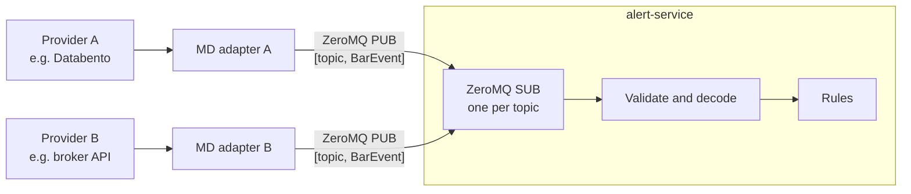

# Market Data Contract

Part of [[00_overview]]. Replaces the earlier assumption in [[01_instruments_and_data]] that the service chooses and fetches its own data. How the service consumes it: [[02_market_data_ingestion]].

## Principle

The service **never requests data**. It only **listens to ZeroMQ** and reacts to bar events. Getting data from a provider and converting it into the format below is the job of a separate **market data (MD) adapter**, written by whoever deploys the service.



The adapter is also responsible for **contract roll**, publishing one continuous series per symbol (details in [[01_instruments_and_data]]).

Everything left of the ZeroMQ line is out of scope for this project. We only document the contract.

## What providers offer (research)

Providers expose pre-aggregated bars at a small set of fixed sizes. For example Databento's OHLCV schemas are `ohlcv-1s`, `ohlcv-1m`, `ohlcv-1h` and `ohlcv-1d`, built from trades. Their `ts_event` is the **inclusive start** of the bar, and **no record is emitted for an interval with no trades**. Polygon/Massive offers 1-second bars too.

Consequences for the contract:
- Bar timestamps mean **bar start**, so we adopt that convention.
- **Gaps are normal**; a missing second is not an error.

Sources: [Databento OHLCV schema](https://databento.com/docs/schemas-and-data-formats/ohlcv), [Databento futures](https://databento.com/futures), [Polygon vs Databento comparison](https://www.edgeful.com/blog/posts/futures-data-api-polygon-databento-edgeful-comparison).

## Bar size: always 1 second

Every bar covers exactly **one second**. The adapters guarantee it, so the bar size appears nowhere in the contract: not in the topic, not in the payload. Every level of the grid down to 22.5 min is a whole number of seconds, so all those windows are exact. The 5.625-min level has half-second boundaries; it is handled by the fixed rule "a bar belongs to the window containing its start time" (see [[02_time_model]]), with an error of at most 0.5 s.

## Topics and messages

| Item | Value |
|------|-------|
| Topic | `<DATATYPE>.<SYMBOL>`, e.g. `OHLCV.ES` |
| Message | ZeroMQ multipart: frame 1 = topic, frame 2 = JSON `BarEvent` |
| Sockets | Adapters bind PUB; the service connects one SUB per topic it needs |

## BarEvent

| Field | Type | Meaning |
|-------|------|---------|
| `symbol` | string | Instrument (e.g. ES, NQ, YM, RTY); the adapter maps provider contract names to these |
| `startTime` | int64 | Bar start, **UTC** epoch **nanoseconds** (inclusive) |
| `open` `high` `low` `close` | decimal | Prices |
| `volume` | int64 | Contracts traded in the bar |

Rules:
- The bar covers `[startTime, startTime + 1 s)`.
- `symbol` must match the topic's symbol.
- **A received bar is final.** There are no in-progress updates and no `final` flag; the adapter sends a bar only once it is complete.
- Bars must be sent in time order per symbol. Late or duplicate bars are not handled for now (see open items).
- **Wire format is JSON**, one bar per ZeroMQ message.

Example (topic `OHLCV.NQ`):

```json
{
  "symbol": "NQ",
  "startTime": 1760133600000000000,
  "open": 25012.25,
  "high": 25013.00,
  "low": 25011.75,
  "close": 25012.75,
  "volume": 42
}
```

## Open items

Decided: JSON wire format, completed bars only, 1-second bars only (no granularity field), multipart `[topic, json]` with one topic per data type and symbol.

Decided: **the adapter handles contract roll**, switching only at the trading-day boundary (18:00 New York). See [[01_instruments_and_data]].

Deferred:
- Late, duplicate, out-of-order and stale bars: **not handled for now**. The service assumes ordered, unique bars per symbol.
- Backtest error measurement: belongs to separate system-level docs.
