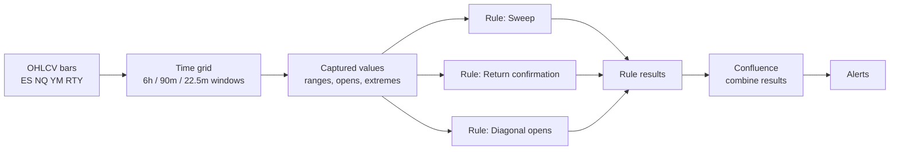
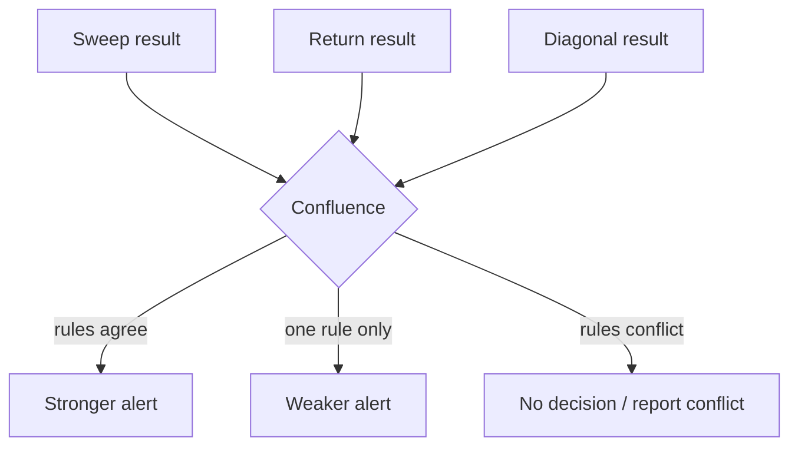

# Rules Engine

Part of [[00_overview]]. The framework is the quarterly theory ([[strategy_philosophy]], [[02_time_model]], [[03_cycle_lifecycle]]). A **rule** is one criterion applied on top of it. This folder has one file per rule.

## Idea

The service is an engine that reads OHLCV bars ([[06_market_data_contract]]), places them into the time grid, and runs independent rules over it. Every rule is time-based and every rule produces its own verdict. When several rules point the same way, that is stronger evidence than one rule alone.

## Rules in scope

| Rule | File | Question it answers | Scope | Fires |
|------|------|---------------------|-------|-------|
| Sweep | [[sweep]] | Did a quarter take out the previous quarter's high or low? | per instrument, any level | when the extreme is taken |
| Return confirmation | [[return_confirmation]] | After a sweep, did price come back? | per instrument, any level | when price returns |
| Diagonal opens | [[diagonal_opens]] | Stage 1: is one instrument moving differently from the others between two fixed points of the day? Stage 2: after breaking the 3-3-3 range, does price end on the matching side of its mean (BUY / SHORT)? | stage 1 across the 4 instruments, stage 2 per instrument | stage 1 at 13:45:00 UTC daily, stage 2 between 14:30:00 and 14:52:30 UTC |

Rules can be added later as new files in this folder without changing the framework.

## Contract between the framework and a rule

Every rule file describes the same things:

| Section | Content |
|---------|---------|
| Inputs | Which captured values it needs (windows, opens, highs, lows) |
| Definition | The test, in numbers |
| Timeline | When it is evaluated |
| Output | The result it emits |
| Open questions | What is still undecided |

Common result shape (conceptual):

| Field | Meaning |
|-------|---------|
| `rule` | Rule name |
| `level` | `session`, `90m`, `22.5m`, or `day` |
| `scope` | One instrument, or the group of four |
| `verdict` | `BULLISH`, `BEARISH`, `NEUTRAL`, or `DIVERGENCE` (for cross-instrument rules) |
| `time` | UTC time the result was produced |
| `evidence` | The numbers behind it |

## Does agreement between rules strengthen a decision?

Yes, with two conditions.

1. **Independence.** Rules that are views of the same event add little. Return confirmation is a continuation of sweep (it cannot exist without it), so a sweep plus a return is one story, not two. The diagonal rule uses different inputs (two fixed opens across four instruments) and is the more independent check.
2. **Comparable verdicts.** Sweep and return say bullish or bearish for one instrument. The diagonal rule says which instrument diverges, not a direction. To combine them the engine needs a mapping from each result to a common form, for example "supports bullish / supports bearish / flags an instrument". How results are scored and combined is undecided.

## Open questions

- Combination: simple count of agreeing rules, weighted score, or required set (e.g. sweep AND return)?
- Level priority: which level (session / 90m / 22.5m) is evaluated and alerted first, and how a lower level agrees with the level above it.
- Do rules emit alerts on their own, or only through the confluence step?
