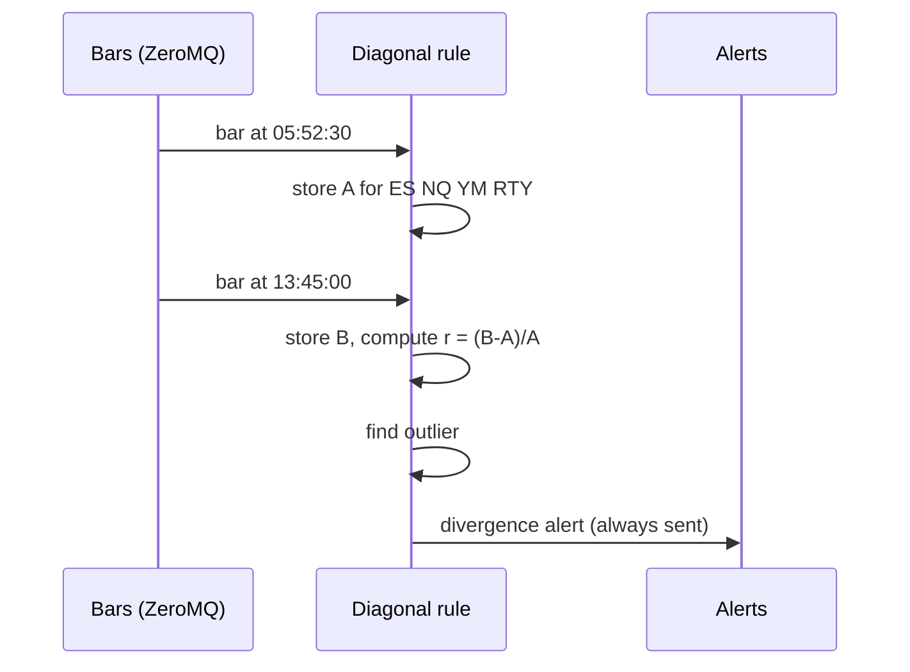

# Rule: Diagonal Opens

Part of [[00_rules_engine]]. Time grid in [[02_time_model]]; data in [[06_market_data_contract]].

## Idea in numbers

A day is **64 blocks of 22.5 minutes**, counted from 22:00 UTC. Each block has a 3-digit address in base 4: (6h quarter, 90-min quarter, 22.5-min quarter), each digit 0-3 (0 = Q1, 1 = Q2, 2 = Q3, 3 = Q4).

The "diagonal" blocks have the same digit three times. The step between consecutive diagonal blocks is always **21 blocks = 7 h 52 m 30 s** (6 h + 1 h 30 min + 22 min 30 s).

| Point | Address | Block | Time (UTC) | Used |
|-------|---------|-------|------------|------|
| Day start | 0,0,0 | 0 | 22:00:00 | no |
| **Opening A** | 1,1,1 (2nd 22.5m of 2nd 90m of 2nd 6h) | 21 | **05:52:30** | yes |
| **Opening B** | 2,2,2 (3rd 22.5m of 3rd 90m of 3rd 6h) | 42 | **13:45:00** | yes |
| NY PM point (later) | 3,3,3 | 63 | 21:37:30 | later |

Check: 22:00 + 21 x 22.5 min = 05:52:30; 22:00 + 42 x 22.5 min = 13:45:00.

```mermaid
gantt
    title Diagonal points inside one trading day (UTC)
    dateFormat HH:mm
    axisFormat %H:%M
    section Daily quarters
    Q1 Asia    :a1, 22:00, 6h
    Q2 London  :a2, after a1, 6h
    Q3 NY AM   :a3, after a2, 6h
    section Points
    Opening A 05:52:30 :milestone, m1, 05:52, 0m
    Opening B 13:45:00 :milestone, m2, 13:45, 0m
```

## Definition

For each instrument (ES, NQ, YM, RTY):

1. **Capture A**: the open price of the first bar that starts at or after 05:52:30 UTC.
2. **Capture B**: the open price of the first bar that starts at or after 13:45:00 UTC.
3. **Compare** B with A by the **size** of the move. The four instruments trade at very different price levels, so the move is normalised: `r = (B - A) / A` (percent change).
4. **Outlier**: the instrument whose `r` is far from the others. Proposed measure: distance between its `r` and the median of the other three; it is an outlier if the distance exceeds a configurable threshold `T`.

> **Deferred:** the outlier threshold `T` (and the final deviation measure) is deferred for now. It will be decided later; the rest of the rule does not depend on it.

## Timeline of the day

| Time (UTC) | Number captured | Action |
|------------|-----------------|--------|
| 22:00 to 05:52:30 | none | Listen and aggregate bars |
| 05:52:30 | A for each of the 4 instruments | Store four numbers |
| 05:52:30 to 13:45:00 | none | Wait |
| 13:45:00 | B for each instrument | Compute four `r`, find the outlier, **send the alert** |
| after 13:45:00 | none | Nothing until the next day |

With `S1` bars the 13:45:00 bar completes at about 13:45:01 and the alert fires then. With `M1` bars it fires at about 13:46. A bar received is final ([[06_market_data_contract]]).



## Worked example (made-up prices)

| Instrument | A (05:52:30) | B (13:45:00) | r = (B-A)/A |
|------------|--------------|--------------|-------------|
| ES | 6000.00 | 6030.00 | +0.50% |
| NQ | 21000.00 | 21105.00 | +0.50% |
| YM | 44000.00 | 44220.00 | +0.50% |
| RTY | 2200.00 | 2178.00 | -1.00% |

Median of the other three for RTY is +0.50%; RTY's distance is 1.50 percentage points. With a threshold of, say, 0.25 pp, RTY is the outlier. Alert: `DIVERGENCE`, outlier RTY, with the four `r` values.

## Output

| Field | Value |
|-------|-------|
| `rule` | Diagonal opens |
| `scope` | The group of four |
| `verdict` | `DIVERGENCE` with the outlier named, or `NEUTRAL` if no single outlier |
| `time` | 13:45:00 UTC (plus bar completion delay) |
| `evidence` | A, B and `r` per instrument, the outlier distance, the threshold used |

The alert is **always sent** at 13:45, including when the split is 2 vs 2 or a move is exactly zero. In those cases it reports "no single outlier" together with the four `r` values.

## Effect of bar granularity

The block start times depend on the 22.5-min rounding policy when only `M1` bars exist ([[06_market_data_contract]]):

| Point | True time | FLOOR (22) | CEIL (23) | ALTERNATE (22,23,22,23) |
|-------|-----------|------------|-----------|-------------------------|
| A, block 21 | 05:52:30 | 05:52 | 05:53 | 05:52 |
| B, block 42 | 13:45:00 | 13:44 | 13:46 | 13:45 |

Under `ALTERNATE`, B is exact and A is 30 s early. With `S1` both are exact.

## Possible extension: other intervals

The rule might also be applied at **lower intervals**, starting from the 90-min level and going down to roughly the 5-min level. This is only a note for now; it is not designed or decided.

The pattern is the same: three nested base-4 digits inside a parent window. For the daily rule the digits are (6h, 90m, 22.5m) inside 24 h. One scale down, the digits would be (90m, 22.5m, ~5m) inside a 6-hour session. Since a diagonal point is always `21/64` of the parent window per step, for a 6h session this gives, counted from the session start:

| Point | Offset from session start | London example (UTC) |
|-------|---------------------------|----------------------|
| A' (1,1,1) | 1 h 58 m 07.5 s | 05:58:07.5 |
| B' (2,2,2) | 3 h 56 m 15 s | 07:56:15 |

Things to settle if this is pursued:
- The third digit is 5 m 37.5 s, not 5 minutes, so exact points need half-second resolution. With `S1` or `M1` bars they are approximate ([[06_market_data_contract]]).
- Whether the lower-interval rule runs inside every session, or only some.
- How the daily result and the lower-interval results combine ([[00_rules_engine]]).

## Open questions

- **Deferred for now:** threshold `T` and the exact deviation measure (distance from the median of the other three, or something else).
- Percent change vs points: percent is assumed because of the different price levels.
- If no bar exists exactly at block start (gaps), the first bar at or after it is used; is a maximum wait needed?
- NY PM point (3,3,3) at 21:37:30 UTC when the fourth session is added.
