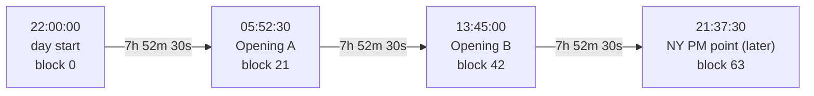
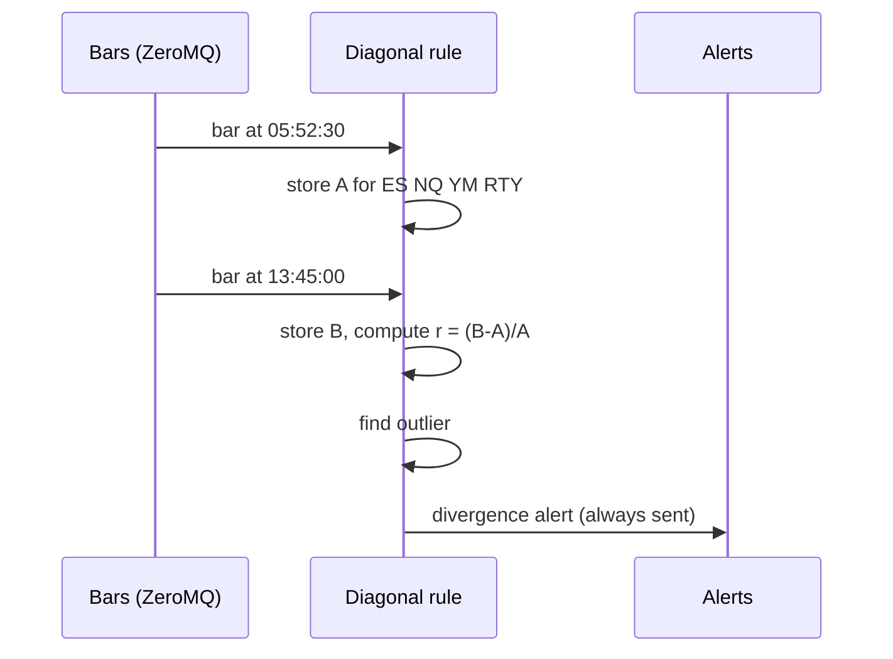
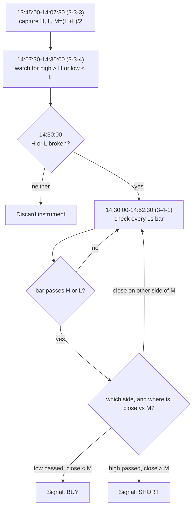

# Rule: Diagonal Opens

Part of [[00_rules_engine]]. Time grid in [[02_time_model]]; data in [[06_market_data_contract]].

This rule has two stages: **stage 1** compares the opening prices A and B across the four instruments; **stage 2** watches the 3-3-3 interval for a failure swing (see "Stage 2" below).

## Idea in numbers

A day is **64 blocks of 22.5 minutes**, counted from 22:00 UTC. Each block has a 3-digit address in base 4: (6h quarter, 90-min quarter, 22.5-min quarter), each digit 0-3 (0 = Q1, 1 = Q2, 2 = Q3, 3 = Q4).

The "diagonal" blocks have the same digit three times. The step between consecutive diagonal blocks is always **21 blocks = 7 h 52 m 30 s** (6 h + 1 h 30 min + 22 min 30 s).

| Point | Address | Block | Time (UTC) | Used |
|-------|---------|-------|------------|------|
| Day start | 0,0,0 | 0 | 22:00:00 | no |
| **Opening A** | 1,1,1 (2nd 22.5m of 2nd 90m of 2nd 6h) | 21 | **05:52:30** | yes |
| **Opening B** | 2,2,2 (3rd 22.5m of 3rd 90m of 3rd 6h) | 42 | **13:45:00** | yes |
| NY PM point (later) | 3,3,3 | 63 | 21:37:30 | later |

Check: 22:00 + 21 x 22.5 min = 05:52:30; 22:00 + 42 x 22.5 min = 13:45:00.

## Definition

For each instrument (ES, NQ, YM, RTY):

1. **Capture A**: the open price of the first bar that starts at or after 05:52:30 UTC.
2. **Capture B**: the open price of the first bar that starts at or after 13:45:00 UTC.
3. **Compare** B with A by the **size** of the move. The four instruments trade at very different price levels, so the move is normalised: `r = (B - A) / A` (percent change).
4. **Outlier**: the instrument whose `r` is far from the others. Proposed measure: distance between its `r` and the median of the other three; it is an outlier if the distance exceeds a configurable threshold `T`.

> **Deferred:** the outlier threshold `T` (and the final deviation measure) is deferred for now. It will be decided later; the rest of the rule does not depend on it.

## Timeline of the day

| Time (UTC) | Number captured | Action |
|------------|-----------------|--------|
| 22:00 to 05:52:30 | none | Listen and aggregate bars |
| 05:52:30 | A for each of the 4 instruments | Store four numbers |
| 05:52:30 to 13:45:00 | none | Wait |
| 13:45:00 | B for each instrument | Compute four `r`, find the outlier, **send the alert** |
| after 13:45:00 | none | Nothing until the next day |

With `S1` bars the 13:45:00 bar completes at about 13:45:01 and the alert fires then. With `M1` bars it fires at about 13:46. A bar received is final ([[06_market_data_contract]]).

## Worked example (made-up prices)

| Instrument | A (05:52:30) | B (13:45:00) | r = (B-A)/A |
|------------|--------------|--------------|-------------|
| ES | 6000.00 | 6030.00 | +0.50% |
| NQ | 21000.00 | 21105.00 | +0.50% |
| YM | 44000.00 | 44220.00 | +0.50% |
| RTY | 2200.00 | 2178.00 | -1.00% |

Median of the other three for RTY is +0.50%; RTY's distance is 1.50 percentage points. With a threshold of, say, 0.25 pp, RTY is the outlier. Alert: `DIVERGENCE`, outlier RTY, with the four `r` values.

## Output

| Field | Value |
|-------|-------|
| `rule` | Diagonal opens |
| `scope` | The group of four |
| `verdict` | `DIVERGENCE` with the outlier named, or `NEUTRAL` if no single outlier |
| `time` | 13:45:00 UTC (plus bar completion delay) |
| `evidence` | A, B and `r` per instrument, the outlier distance, the threshold used |

The alert is **always sent** at 13:45, including when the split is 2 vs 2 or a move is exactly zero. In those cases it reports "no single outlier" together with the four `r` values.

## Stage 2: failure swing on the 3-3-3 range

After the opening comparison, the rule looks inside the 3-3-3 interval itself. Addresses below are written 1-based (3-3-3 = 3rd 6h, 3rd 90m, 3rd 22.5m), which is the 0-based block address (2,2,2) used above.

### Intervals involved (UTC)

| Name | Meaning | 0-based address | Block | Start | End |
|------|---------|-----------------|-------|-------|-----|
| **3-3-3** | 3rd 22.5m of 3rd 90m of Q3 | 2,2,2 | 42 | 13:45:00 | 14:07:30 |
| **3-3-4** | 4th 22.5m of 3rd 90m of Q3 | 2,2,3 | 43 | 14:07:30 | 14:30:00 |
| **3-4-1** | 1st 22.5m of 4th 90m of Q3 | 2,3,0 | 44 | 14:30:00 | 14:52:30 |

### Values

For each instrument, from the bars of 3-3-3 [13:45:00, 14:07:30):

| Value | Formula |
|-------|---------|
| `H` | highest `high` |
| `L` | lowest `low` |
| `M` (mean) | `(H + L) / 2`, the midpoint of the range |

`M` splits the range into a lower half (prices below `M`) and an upper half (prices above `M`). In trading words the lower half is "discount" and the upper half is "premium"; in numbers it is just `price < M` or `price > M`.

### Algorithm, per instrument (ES, NQ, YM, RTY)

1. **Capture** `H`, `L`, `M` during 3-3-3. They are frozen at 14:07:30.
2. **Wait through 3-3-4** [14:07:30, 14:30:00). Mark `highBroken` if any bar has `high > H`, and `lowBroken` if any bar has `low < L`.
3. **Gate at 14:30:00** (start of 3-4-1):
   - neither broken → **discard** the instrument for the day.
   - otherwise → the instrument is a **candidate**; keep looking at it.
4. **Watch every 1-second bar of 3-4-1** [14:30:00, 14:52:30) for each candidate. For each bar:
   - **Break event**: the bar passes an extremity, i.e. `bar.high > H` or `bar.low < L`. This is reported as "extremity passed".
   - **Failure swing check** on that same bar, using its `close` as the current price:
     - low passed (`bar.low < L`) **and** `close < M` → **BUY** signal (price is in the lower half after breaking the low).
     - high passed (`bar.high > H`) **and** `close > M` → **SHORT** signal (price is in the upper half after breaking the high).
     - otherwise (the bar passed an extremity but closed on the other side of `M`) → no signal from this bar.
5. **Signal time**: when the qualifying bar is received, i.e. its start + 1 s with `S1` bars. If no bar qualifies by 14:52:30, nothing is emitted for that instrument.

### Timeline of stage 2

| Time (UTC) | Number captured | Action |
|------------|-----------------|--------|
| 13:45:00-14:07:30 | running `H`, `L` per instrument | Update extremes with each bar |
| 14:07:30 | `H`, `L`, `M` frozen | Store the three numbers |
| 14:07:30-14:30:00 | any price above `H` or below `L` | Set `highBroken` / `lowBroken` |
| 14:30:00 | none | Discard instruments with no break |
| 14:30:00-14:52:30 | each 1s bar of each candidate | Test `high > H` / `low < L`, then compare `close` with `M` |
| first qualifying bar | the bar's `close`, `H`, `L`, `M` | Emit BUY or SHORT |

### Worked example (made-up prices)

| Instrument | H | L | M | 3-3-4 high / low | Candidate? |
|------------|---|---|---|------------------|------------|
| ES | 6032.00 | 6026.00 | 6029.00 | 6031.50 / 6027.00 | no, discarded |
| NQ | 21120.00 | 21090.00 | 21105.00 | 21118.00 / 21092.00 | no, discarded |
| YM | 44240.00 | 44180.00 | 44210.00 | 44235.00 / 44170.00 | yes (low broken) |
| RTY | 2185.00 | 2178.00 | 2181.50 | 2187.50 / 2179.00 | yes (high broken) |

In 3-4-1:
- **YM**: the 1s bar at 14:33:12 has `low` 44168.00 (< L 44180) and `close` 44172.00 (< M 44210) → **BUY**, signalled at 14:33:13.
- **RTY**: the 1s bar at 14:31:05 has `high` 2186.00 (> H 2185) and `close` 2185.50 (> M 2181.50) → **SHORT**, signalled at 14:31:06.
- If RTY's bar had closed at 2181.00 (below M) the extremity would still be reported as passed, but there would be no SHORT.

### Output

| Field | Value |
|-------|-------|
| `rule` | Diagonal opens, failure swing |
| `scope` | One instrument |
| `verdict` | `BULLISH` (BUY) or `BEARISH` (SHORT) |
| `time` | When the qualifying bar was received |
| `evidence` | `H`, `L`, `M`, which side was broken in 3-3-4, the 3-4-1 bar that passed the extremity (time, high, low, close) |

An "extremity passed" event is also reported for bars that pass `H` or `L` but do not qualify for a signal.

### Effect of bar granularity (stage 2)

- The 3-4-1 watch is designed for **`S1`** bars. With `M1` bars the same test runs on minute-sized bars, so a signal is later and coarser, and a minute bar's `close` may sit far from where the extremity was passed.
- The decision time 14:30:00 is a 90-min boundary, so it is exact under every rounding policy. The edges inside the 90-min quarter move with `M1` ([[06_market_data_contract]]):

| Policy | 3-3-3 | 3-3-4 |
|--------|-------|-------|
| True (`S1`) | 13:45:00-14:07:30 | 14:07:30-14:30:00 |
| `FLOOR` (22) | 13:44-14:06 | 14:06-14:30 |
| `CEIL` (23) | 13:46-14:09 | 14:09-14:30 |
| `ALTERNATE` (22,23,22,23) | 13:45-14:07 | 14:07-14:30 |

### Interpretations to confirm

- `M` is the midpoint `(H + L) / 2`. Alternative: the average of the closes (or of all prices) in 3-3-3.
- "Current price" for the mean test is the `close` of the 1s bar that passed the extremity. Alternative: the extreme price itself (which is always on the extreme side of `M`, making the test trivial).
- In 3-4-1 either extremity counts. Alternative: only the side that was broken in 3-3-4.
- One signal per instrument (the first qualifying bar), or a signal on every qualifying bar?
- If an instrument is a candidate on both sides (both `H` and `L` broken in 3-3-4): both sides are watched in 3-4-1 as written; confirm.
- Relation to stage 1 (opening comparison and outlier): stage 2 currently runs for **every** instrument independently. Whether it should only run on the outlier from stage 1 is undecided.

## Effect of bar granularity (stage 1)

The block start times depend on the 22.5-min rounding policy when only `M1` bars exist ([[06_market_data_contract]]):

| Point | True time | FLOOR (22) | CEIL (23) | ALTERNATE (22,23,22,23) |
|-------|-----------|------------|-----------|-------------------------|
| A, block 21 | 05:52:30 | 05:52 | 05:53 | 05:52 |
| B, block 42 | 13:45:00 | 13:44 | 13:46 | 13:45 |

Under `ALTERNATE`, B is exact and A is 30 s early. With `S1` both are exact.

## Possible extension: other intervals

The rule might also be applied at **lower intervals**, starting from the 90-min level and going down to roughly the 5-min level. This is only a note for now; it is not designed or decided.

The pattern is the same: three nested base-4 digits inside a parent window. For the daily rule the digits are (6h, 90m, 22.5m) inside 24 h. One scale down, the digits would be (90m, 22.5m, ~5m) inside a 6-hour session. Since a diagonal point is always `21/64` of the parent window per step, for a 6h session this gives, counted from the session start:

| Point | Offset from session start | London example (UTC) |
|-------|---------------------------|----------------------|
| A' (1,1,1) | 1 h 58 m 07.5 s | 05:58:07.5 |
| B' (2,2,2) | 3 h 56 m 15 s | 07:56:15 |

Things to settle if this is pursued:
- The third digit is 5 m 37.5 s, not 5 minutes, so exact points need half-second resolution. With `S1` or `M1` bars they are approximate ([[06_market_data_contract]]).
- Whether the lower-interval rule runs inside every session, or only some.
- How the daily result and the lower-interval results combine ([[00_rules_engine]]).

## Open questions

- **Deferred for now:** threshold `T` and the exact deviation measure (distance from the median of the other three, or something else).
- Percent change vs points: percent is assumed because of the different price levels.
- If no bar exists exactly at block start (gaps), the first bar at or after it is used; is a maximum wait needed?
- NY PM point (3,3,3) at 21:37:30 UTC when the fourth session is added.
