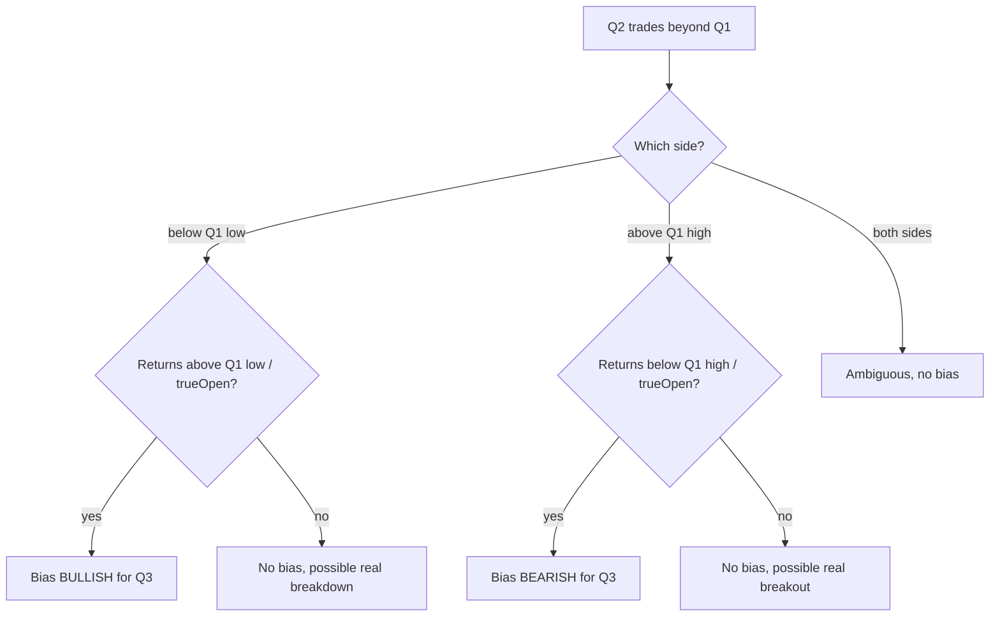
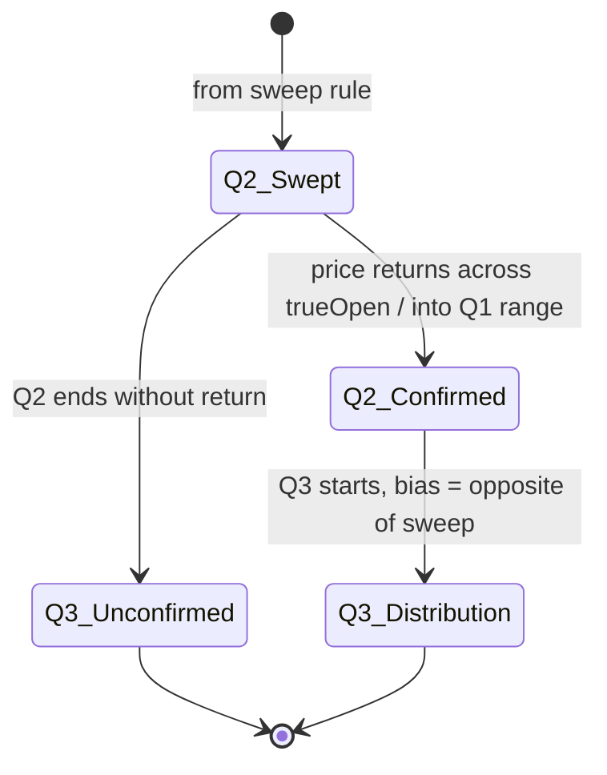

# Rule: Return Confirmation

Part of [[00_rules_engine]]. Depends on [[sweep]]: it only runs after a sweep has happened.

## Idea

A sweep alone could be a real breakout. If price comes **back** after the sweep, the sweep looks like a false move, and the expected direction for Q3 is the opposite of the sweep.

## Inputs

| Value | From |
|-------|------|
| Which side was swept, and when | [[sweep]] |
| `q1High`, `q1Low`, `trueOpen` | Cycle capture ([[03_cycle_lifecycle]]) |
| Bars after the sweep | As they arrive |

## Definition

- After a **low** sweep: price returns above `q1Low` (or above `trueOpen`, see open questions) before Q2 ends. Verdict `BULLISH` for Q3.
- After a **high** sweep: price returns below `q1High` (or below `trueOpen`) before Q2 ends. Verdict `BEARISH` for Q3.
- No return before Q2 ends: no confirmation. It may be a real breakout or breakdown.
- Both sides swept: ambiguous, no confirmation.

## State (return part)

## Output

| Field | Value |
|-------|-------|
| `rule` | Return confirmation |
| `scope` | One instrument |
| `verdict` | `BULLISH` / `BEARISH` / `NEUTRAL` |
| `evidence` | Swept side, sweep time, return time, price at return |

## Open questions

- Return means: back across `trueOpen`, or back inside the Q1 range?
- Must the return be a bar close, or is a wick enough?
- How long after the sweep is a return still valid (before Q2 ends only, or into Q3)?
