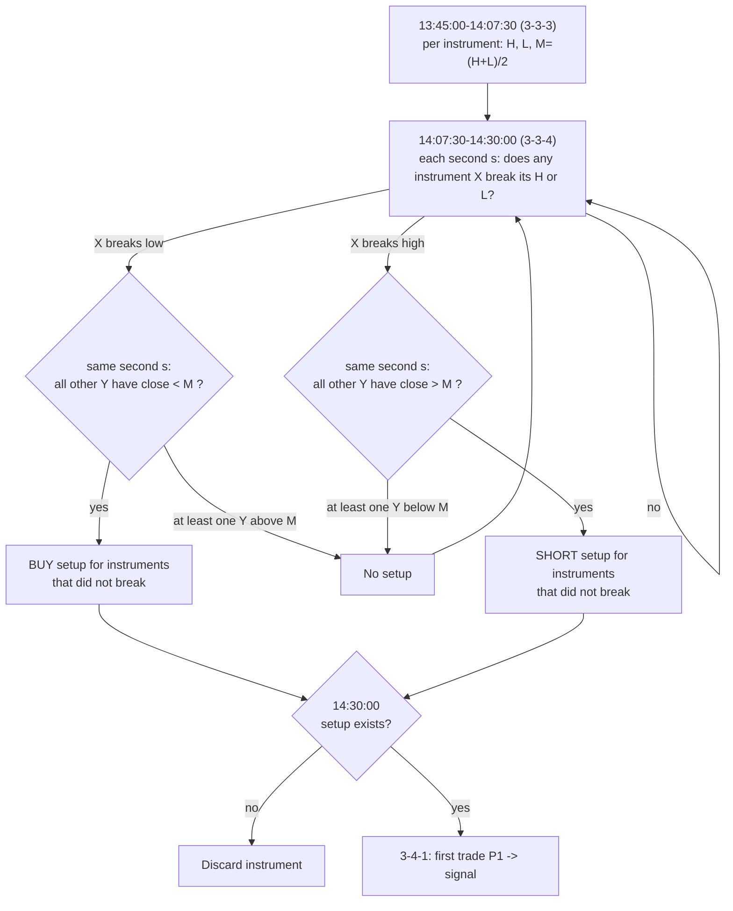

# Rule: Sequence Range Sweep

Part of [[00_rules_engine]]. Time grid in [[02_time_model]]; data in [[06_market_data_contract]].

## Name

This rule was first called "diagonal opens". It no longer compares opening prices between intervals, so the name was dropped. Public material that describes similar ideas:
- ICT **Turtle Soup**: price sweeps a range high/low (liquidity), then the breakout fails and price reverses. Sweep of highs gives SHORT, sweep of lows gives LONG.
- ICT **premium / discount**: a range is split at its 50% level; the upper half is premium, the lower half is discount.
- Daye's Quarterly Theory indicators on TradingView (for example "Quarter Sequence Chains") show chains of consecutive quarters across nested levels, which is the 3-3-3 → 3-3-4 → 3-4-1 sequence used here.

The rule combines those: the range of one 22.5-minute quarter, a sweep of that range by one instrument in the next quarter, and a premium/discount test of the other instruments against their own range means. The comparison across ES, NQ, YM and RTY is similar in spirit to SMT divergence ([[04_ssmt]]). Working name: **Sequence Range Sweep**. It is separate from [[sweep]], which sweeps the Q1 range of a cycle during Q2.

Sources: [ICT Turtle Soup](https://www.mql5.com/it/market/product/184692), [ICT premium/discount](https://www.luxalgo.com/library/indicator/lgjVkiDL-ict-premium-discount/), [Daye Quarter Sequence Chains](https://kr.tradingview.com/scripts/daye/).

## Idea in numbers

A day is **64 blocks of 22.5 minutes**, counted from 22:00 UTC. A block has a 3-digit address in base 4: (6h quarter, 90-min quarter, 22.5-min quarter). In this note the quarters are written **1-based** (3-3-3 = 3rd 6h, 3rd 90m, 3rd 22.5m), which is the 0-based address (2,2,2) used in [[02_time_model]].

| Name | Meaning | 0-based address | Block | Start (UTC) | End (UTC) |
|------|---------|-----------------|-------|-------------|-----------|
| **3-3-3** | 3rd 22.5m of 3rd 90m of Q3 | 2,2,2 | 42 | 13:45:00 | 14:07:30 |
| **3-3-4** | 4th 22.5m of 3rd 90m of Q3 | 2,2,3 | 43 | 14:07:30 | 14:30:00 |
| **3-4-1** | 1st 22.5m of 4th 90m of Q3 | 2,3,0 | 44 | 14:30:00 | 14:52:30 |

Check: 22:00 + 42 x 22.5 min = 13:45:00; 22:00 + 43 x 22.5 min = 14:07:30; 22:00 + 44 x 22.5 min = 14:30:00.

## Values

For each instrument (ES, NQ, YM, RTY), from the bars of 3-3-3 [13:45:00, 14:07:30):

| Value | Formula |
|-------|---------|
| `H` | highest `high` |
| `L` | lowest `low` |
| `M` (mean) | `(H + L) / 2`, the midpoint of the range |

`M` splits the range into a lower half (`price < M`) and an upper half (`price > M`). In trading words these are "discount" and "premium".

## Algorithm (four instruments together)

The four instruments are compared with each other. Notation: `X` is the instrument that breaks an extremity, `Y` is any of the other three. Each instrument has its own `H`, `L`, `M` from its own 3-3-3.

1. **Capture** `H`, `L`, `M` for every instrument during 3-3-3. They are frozen at 14:07:30.
2. **Watch every 1-second bar of 3-3-4** [14:07:30, 14:30:00). For each second `s`:
   - **Trigger**: an instrument `X` has a bar at `s` that breaks its own extremity: `X.high > X.H` (high break) or `X.low < X.L` (low break).
   - **Look at the others at the same second `s`**: for every other instrument `Y` compare the `close` of its 1s bar at `s` with its own mean `Y.M`.
   - **Low break** (`X.low < X.L`): if **every** `Y` has `Y.close < Y.M` → **BUY setup** for the instruments that did **not** break. If **at least one** `Y` has `Y.close > Y.M` → no setup (the instruments disagree, "we should not buy").
   - **High break** (`X.high > X.H`): if **every** `Y` has `Y.close > Y.M` → **SHORT setup** for the instruments that did not break. If **at least one** `Y` has `Y.close < Y.M` → no setup.
3. **Gate at 14:30:00**: an instrument with no setup is **discarded** for the day. An instrument with a setup is kept.
4. **Signal at the first trade of 3-4-1**: let `P1` = open of the first bar that starts at or after 14:30:00. For each kept instrument emit **BUY** or **SHORT** with `P1` as the entry reference, together with its `H`, `L`, `M` and the setup record (who triggered, at which second, and the closes and means used).
5. **Signal time**: when `P1` is received, about 14:30:01 UTC with `S1` bars and about 14:31:00 with `M1` bars (a received bar is final, see [[06_market_data_contract]]). Nothing happens after the signal until the next day.

In words: one instrument breaking its range, while the other three are all on the same half of their ranges (below their means for a low break, above their means for a high break), makes those other three the instruments to act on.

## Timeline

| Time (UTC) | Number captured | Action |
|------------|-----------------|--------|
| 22:00 to 13:45:00 | none | Listen and aggregate bars |
| 13:45:00-14:07:30 | running `H`, `L` for each of the 4 instruments | Update extremes with each bar |
| 14:07:30 | `H`, `L`, `M` for each instrument frozen | Store 12 numbers |
| 14:07:30-14:30:00 | each 1s bar of each instrument | Detect a break; at that second compare the other instruments' `close` with their `M`; record setups |
| 14:30:00 | none | Discard instruments without a setup |
| 14:30:00 (first bar) | `P1` | Emit BUY / SHORT for each instrument with a setup |

## Worked example (made-up prices)

Values from 3-3-3:

| Instrument | H | L | M |
|------------|---|---|---|
| ES | 6032.00 | 6026.00 | 6029.00 |
| NQ | 21120.00 | 21090.00 | 21105.00 |
| YM | 44240.00 | 44180.00 | 44210.00 |
| RTY | 2185.00 | 2178.00 | 2181.50 |

At 14:12:40 YM's bar has `low` 44168.00 < L 44180.00: **trigger, low break** by YM. Closes of the others in the same second:

| Instrument | close at 14:12:40 | M | close < M ? |
|------------|-------------------|---|-------------|
| ES | 6027.50 | 6029.00 | yes |
| NQ | 21098.00 | 21105.00 | yes |
| RTY | 2179.80 | 2181.50 | yes |

All three are below their means → **BUY setup for ES, NQ, RTY** (the instruments that did not break). YM gets no setup.

At 14:30:00 the first bars of 3-4-1 give `P1`: ES 6028.25, NQ 21100.50, RTY 2180.20. Signals: **BUY ES** (6028.25), **BUY NQ** (21100.50), **BUY RTY** (2180.20), each with its `H`, `L`, `M` and the trigger record (YM, 14:12:40).

Variant: if NQ had closed at 21110.00 (above its `M`) at 14:12:40, one instrument disagrees, so there is no setup from that trigger and nothing would be signalled.

## Output

| Field | Value |
|-------|-------|
| `rule` | Sequence range sweep |
| `scope` | One instrument (a target that did not break), derived from the group |
| `verdict` | `BULLISH` (BUY) after a low break, `BEARISH` (SHORT) after a high break |
| `time` | When `P1` was received |
| `evidence` | Trigger instrument and bar (time, high or low), the closes and means of the other instruments at that second, the target's `H`, `L`, `M`, `P1` |

An "extremity passed" event is also reported for every break, including ones that do not create a setup.

## Effect of bar granularity

- The watch in 3-3-4 is designed for **`S1`** bars. With `M1` bars the same test runs on minute bars, so setups are coarser and a minute bar's `close` can sit far from where the extremity was passed.
- The decision time 14:30:00 is a 90-min boundary, so it is exact under every rounding policy. The edges inside the 90-min quarter move with `M1` ([[06_market_data_contract]]):

| Policy | 3-3-3 | 3-3-4 |
|--------|-------|-------|
| True (`S1`) | 13:45:00-14:07:30 | 14:07:30-14:30:00 |
| `FLOOR` (22) | 13:44-14:06 | 14:06-14:30 |
| `CEIL` (23) | 13:46-14:09 | 14:09-14:30 |
| `ALTERNATE` (22,23,22,23) | 13:45-14:07 | 14:07-14:30 |

## Possible extension: other intervals

The same sequence (range of one quarter, sweep in the next, signal at the start of the one after) might also be used at **lower intervals**, from the 90-min level down to roughly the 5-min level. This is only a note; it is not designed or decided.

The sequence sits at fixed fractions of its parent window: 3-3-3 starts at 42/64, 3-3-4 at 43/64, 3-4-1 at 44/64 and ends at 45/64. Inside a 6-hour session (quarters of 90m, 22.5m and about 5m37.5s):

| Point | Offset from session start | London example (UTC) |
|-------|---------------------------|----------------------|
| 3-3-3 start | 3 h 56 m 15 s | 07:56:15 |
| 3-3-4 start | 4 h 01 m 52.5 s | 08:01:52.5 |
| 3-4-1 start | 4 h 07 m 30 s | 08:07:30 |
| 3-4-1 end | 4 h 13 m 07.5 s | 08:13:07.5 |

Things to settle if this is pursued:
- The lowest level is 5 m 37.5 s, not 5 minutes, so exact boundaries need half-second resolution. With `S1` or `M1` bars they are approximate.
- Whether the rule runs inside every session, or only some.
- How results from different intervals combine ([[00_rules_engine]]).

## Interpretations to confirm

- `M` is the midpoint `(H + L) / 2` of each instrument's own 3-3-3 (the word "median" was used in discussion; this note uses the midpoint). Alternative: the statistical median or the average of the closes.
- The trigger is only the break of an extremity by `X`. The earlier test of `X`'s own close against its own mean is no longer used. Confirm.
- "Signal in the same direction" is read through the discount/premium mapping: low break with the others below their means gives BUY, high break with the others above their means gives SHORT. The opposite mapping (low break gives SELL) is not used.
- "At least one" other instrument on the opposite side of its mean cancels the trigger. Equivalent to: all three others must be on the matching side.
- The signal is issued for the instruments that **did not break** at that second.
- "Same second": the 1s bar with the same start time as `X`'s breaking bar. If an instrument has no bar in that second (no trades), its latest known close is used (alternative: no setup).
- The signal is emitted at the first trade of 3-4-1 (14:30:00). Alternative: emit as soon as the setup is created inside 3-3-4.
- Once a setup exists, later bars in 3-3-4 do not cancel it. Alternative: cancel or update it if the situation reverses.
- Several triggers: if instruments break in both directions, or break at different seconds, which setup wins? Undecided. Currently the first setup per target is recorded.
- Is an instrument that broke at an earlier second still a target for a later trigger? Undecided.
