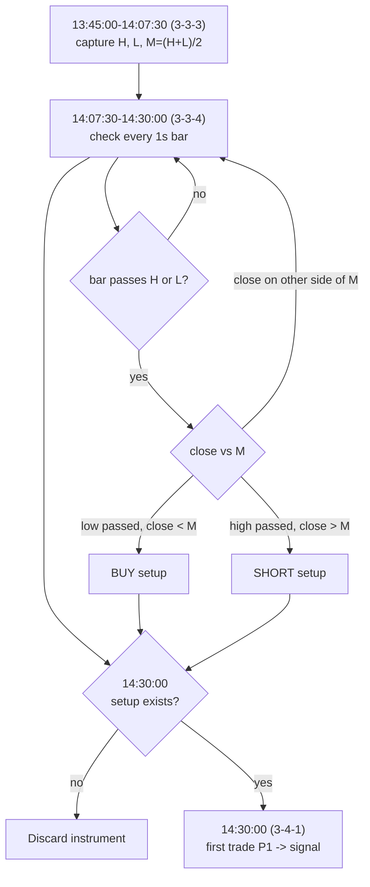

# Rule: Sequence Range Sweep

Part of [[00_rules_engine]]. Time grid in [[02_time_model]]; data in [[06_market_data_contract]].

## Name

This rule was first called "diagonal opens". It no longer compares opening prices between intervals, so the name was dropped. Public material that describes similar ideas:
- ICT **Turtle Soup**: price sweeps a range high/low (liquidity), then the breakout fails and price reverses. Sweep of highs gives SHORT, sweep of lows gives LONG.
- ICT **premium / discount**: a range is split at its 50% level; the upper half is premium, the lower half is discount.
- Daye's Quarterly Theory indicators on TradingView (for example "Quarter Sequence Chains") show chains of consecutive quarters across nested levels, which is the 3-3-3 → 3-3-4 → 3-4-1 sequence used here.

The rule combines those: the range of one 22.5-minute quarter, a sweep of that range in the next quarter, and a premium/discount test against the range mean. Working name: **Sequence Range Sweep**. It is separate from [[sweep]], which sweeps the Q1 range of a cycle during Q2.

Sources: [ICT Turtle Soup](https://www.mql5.com/it/market/product/184692), [ICT premium/discount](https://www.luxalgo.com/library/indicator/lgjVkiDL-ict-premium-discount/), [Daye Quarter Sequence Chains](https://kr.tradingview.com/scripts/daye/).

## Idea in numbers

A day is **64 blocks of 22.5 minutes**, counted from 22:00 UTC. A block has a 3-digit address in base 4: (6h quarter, 90-min quarter, 22.5-min quarter). In this note the quarters are written **1-based** (3-3-3 = 3rd 6h, 3rd 90m, 3rd 22.5m), which is the 0-based address (2,2,2) used in [[02_time_model]].

| Name | Meaning | 0-based address | Block | Start (UTC) | End (UTC) |
|------|---------|-----------------|-------|-------------|-----------|
| **3-3-3** | 3rd 22.5m of 3rd 90m of Q3 | 2,2,2 | 42 | 13:45:00 | 14:07:30 |
| **3-3-4** | 4th 22.5m of 3rd 90m of Q3 | 2,2,3 | 43 | 14:07:30 | 14:30:00 |
| **3-4-1** | 1st 22.5m of 4th 90m of Q3 | 2,3,0 | 44 | 14:30:00 | 14:52:30 |

Check: 22:00 + 42 x 22.5 min = 13:45:00; 22:00 + 43 x 22.5 min = 14:07:30; 22:00 + 44 x 22.5 min = 14:30:00.

## Values

For each instrument (ES, NQ, YM, RTY), from the bars of 3-3-3 [13:45:00, 14:07:30):

| Value | Formula |
|-------|---------|
| `H` | highest `high` |
| `L` | lowest `low` |
| `M` (mean) | `(H + L) / 2`, the midpoint of the range |

`M` splits the range into a lower half (`price < M`) and an upper half (`price > M`). In trading words these are "discount" and "premium".

## Algorithm, per instrument

1. **Capture** `H`, `L`, `M` during 3-3-3. They are frozen at 14:07:30.
2. **Watch every 1-second bar of 3-3-4** [14:07:30, 14:30:00). For each bar:
   - **Extremity broken**: `bar.high > H` or `bar.low < L`. Report it as "extremity passed".
   - On a break, **compare the bar with the mean `M`**, using the bar's `close` as the current price:
     - low broken (`bar.low < L`) **and** `close < M` → **BUY setup** (lower half after breaking the low).
     - high broken (`bar.high > H`) **and** `close > M` → **SHORT setup** (upper half after breaking the high).
     - otherwise (broke an extremity but closed on the other side of `M`) → no setup from this bar.
3. **Gate at 14:30:00**: an instrument with no setup is **discarded** for the day. An instrument with a setup is kept.
4. **Signal at the first trade of 3-4-1**: let `P1` = open of the first bar that starts at or after 14:30:00. For each kept instrument, emit **BUY** or **SHORT** with `P1` as the entry reference, together with `H`, `L`, `M` and the bar that created the setup.
5. **Signal time**: when `P1` is received, about 14:30:01 UTC with `S1` bars and about 14:31:00 with `M1` bars (a received bar is final, see [[06_market_data_contract]]). Nothing happens after the signal until the next day.

## Timeline

| Time (UTC) | Number captured | Action |
|------------|-----------------|--------|
| 22:00 to 13:45:00 | none | Listen and aggregate bars |
| 13:45:00-14:07:30 | running `H`, `L` per instrument | Update extremes with each bar |
| 14:07:30 | `H`, `L`, `M` frozen | Store the three numbers |
| 14:07:30-14:30:00 | each 1s bar | Test `high > H` / `low < L`, then compare `close` with `M`; remember the setup |
| 14:30:00 | none | Discard instruments without a setup |
| 14:30:00 (first bar) | `P1` | Emit BUY / SHORT for each instrument with a setup |

## Worked example (made-up prices)

| Instrument | H | L | M | 3-3-4 bar that broke | Setup |
|------------|---|---|---|----------------------|-------|
| ES | 6032.00 | 6026.00 | 6029.00 | none (3-3-4 range 6027.00-6031.50) | none, discarded |
| NQ | 21120.00 | 21090.00 | 21105.00 | none (3-3-4 range 21092.00-21118.00) | none, discarded |
| YM | 44240.00 | 44180.00 | 44210.00 | 14:12:40: low 44168.00 < L, close 44172.00 < M | **BUY** |
| RTY | 2185.00 | 2178.00 | 2181.50 | 14:21:05: high 2186.00 > H, close 2185.50 > M | **SHORT** |

At 14:30:00 the first bars of 3-4-1 give `P1`: YM 44175.00, RTY 2184.80. Signals: **BUY YM** (entry reference 44175.00) and **SHORT RTY** (entry reference 2184.80), each carrying its `H`, `L`, `M`.

If RTY's breaking bar had closed at 2181.00 (below `M`), the extremity would still be reported as passed but there would be no setup and no SHORT.

## Output

| Field | Value |
|-------|-------|
| `rule` | Sequence range sweep |
| `scope` | One instrument |
| `verdict` | `BULLISH` (BUY) or `BEARISH` (SHORT) |
| `time` | When `P1` was received |
| `evidence` | `H`, `L`, `M`, the 3-3-4 bar that created the setup (time, high, low, close), `P1` |

An "extremity passed" event is also reported for bars that pass `H` or `L` but do not create a setup.

## Effect of bar granularity

- The watch in 3-3-4 is designed for **`S1`** bars. With `M1` bars the same test runs on minute bars, so setups are coarser and a minute bar's `close` can sit far from where the extremity was passed.
- The decision time 14:30:00 is a 90-min boundary, so it is exact under every rounding policy. The edges inside the 90-min quarter move with `M1` ([[06_market_data_contract]]):

| Policy | 3-3-3 | 3-3-4 |
|--------|-------|-------|
| True (`S1`) | 13:45:00-14:07:30 | 14:07:30-14:30:00 |
| `FLOOR` (22) | 13:44-14:06 | 14:06-14:30 |
| `CEIL` (23) | 13:46-14:09 | 14:09-14:30 |
| `ALTERNATE` (22,23,22,23) | 13:45-14:07 | 14:07-14:30 |

## Possible extension: other intervals

The same sequence (range of one quarter, sweep in the next, signal at the start of the one after) might also be used at **lower intervals**, from the 90-min level down to roughly the 5-min level. This is only a note; it is not designed or decided.

The sequence sits at fixed fractions of its parent window: 3-3-3 starts at 42/64, 3-3-4 at 43/64, 3-4-1 at 44/64 and ends at 45/64. Inside a 6-hour session (quarters of 90m, 22.5m and about 5m37.5s):

| Point | Offset from session start | London example (UTC) |
|-------|---------------------------|----------------------|
| 3-3-3 start | 3 h 56 m 15 s | 07:56:15 |
| 3-3-4 start | 4 h 01 m 52.5 s | 08:01:52.5 |
| 3-4-1 start | 4 h 07 m 30 s | 08:07:30 |
| 3-4-1 end | 4 h 13 m 07.5 s | 08:13:07.5 |

Things to settle if this is pursued:
- The lowest level is 5 m 37.5 s, not 5 minutes, so exact boundaries need half-second resolution. With `S1` or `M1` bars they are approximate.
- Whether the rule runs inside every session, or only some.
- How results from different intervals combine ([[00_rules_engine]]).

## Interpretations to confirm

- `M` is the midpoint `(H + L) / 2`. Alternative: the average of the closes (or of all prices) in 3-3-3.
- "Compare with the mean" uses the **close** of the 1s bar that broke the extremity. Alternative: the extreme price itself (always on the extreme side of `M`, which makes the test trivial).
- The signal is emitted at the first trade of 3-4-1 (14:30:00). Alternative: emit as soon as the setup bar is received inside 3-3-4.
- Once a setup exists, later bars in 3-3-4 do not cancel it. Alternative: cancel or update the setup if price later reverses (for example closes back on the other side of `M`).
- If both sides create a setup in 3-3-4 (a BUY setup and a SHORT setup): undecided.
- If several bars create a setup on the same side, the first one is recorded; confirm.
