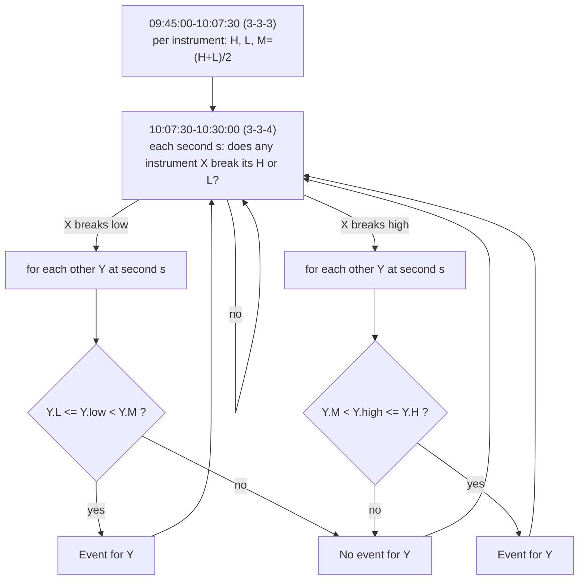

# Rule: Sequence Range Sweep

Part of [[00_rules_engine]]. Time grid in [[02_time_model]]; data in [[06_market_data_contract]].

## Name

This rule was first called "diagonal opens". It no longer compares opening prices between intervals, so the name was dropped. Public material that describes similar ideas:
- ICT **Turtle Soup**: price sweeps a range high/low (liquidity), then the breakout fails and price reverses.
- ICT **premium / discount**: a range is split at its 50% level; the upper half is premium, the lower half is discount.
- Daye's Quarterly Theory indicators on TradingView (for example "Quarter Sequence Chains") show chains of consecutive quarters across nested levels, which is the 3-3-3 → 3-3-4 sequence used here.

The rule combines those: the range of one 22.5-minute quarter (3-3-3), a sweep of that range by one instrument in the next quarter (3-3-4), and a premium/discount test of each other instrument against its own range mean. The comparison across ES, NQ, YM and RTY is similar in spirit to SMT divergence ([[04_ssmt]]). It is separate from [[sweep]], which sweeps the Q1 range of a cycle during Q2.

Sources: [ICT Turtle Soup](https://www.mql5.com/it/market/product/184692), [ICT premium/discount](https://www.luxalgo.com/library/indicator/lgjVkiDL-ict-premium-discount/), [Daye Quarter Sequence Chains](https://kr.tradingview.com/scripts/daye/).

## Idea in numbers

A day is **64 blocks of 22.5 minutes**, counted from the 18:00 New York day start. A block has a 3-digit address in base 4: (6h quarter, 90-min quarter, 22.5-min quarter). In this note the quarters are written **1-based** (3-3-3 = 3rd 6h, 3rd 90m, 3rd 22.5m), which is the 0-based address (2,2,2) used in [[02_time_model]].

| Name | Meaning | 0-based address | Block | Start (NY) | End (NY) |
|------|---------|-----------------|-------|-------------|-----------|
| **3-3-3** | 3rd 22.5m of 3rd 90m of Q3 | 2,2,2 | 42 | 09:45:00 | 10:07:30 |
| **3-3-4** | 4th 22.5m of 3rd 90m of Q3 | 2,2,3 | 43 | 10:07:30 | 10:30:00 |

Check: 18:00 + 42 x 22.5 min = 09:45:00; 18:00 + 43 x 22.5 min = 10:07:30; 18:00 + 44 x 22.5 min = 10:30:00.

In UTC: 3-3-3 is 13:45:00-14:07:30 and 3-3-4 is 14:07:30-14:30:00 while the US is on EDT; one hour later (14:45:00 / 15:07:30 / 15:30:00) on EST. All times below are New York time.

## Values

For each instrument (ES, NQ, YM, RTY), from the bars of 3-3-3 [09:45:00, 10:07:30):

| Value | Formula |
|-------|---------|
| `H` | highest `high` |
| `L` | lowest `low` |
| `M` (mean) | `(H + L) / 2`, the midpoint of the range |

`M` splits the range into a lower half (`price < M`) and an upper half (`price > M`). In trading words these are "discount" and "premium".

## Algorithm (four instruments together)

The four instruments are compared with each other. Notation: `X` is the instrument that breaks an extremity (the trigger), `Y` is any of the other three (a candidate target). Each instrument has its own `H`, `L`, `M` from its own 3-3-3.

1. **Capture** `H`, `L`, `M` for every instrument during 3-3-3. They are frozen at 10:07:30.
2. **Watch every 1-second bar of 3-3-4** [10:07:30, 10:30:00). For each second `s`:
   - **Trigger**: an instrument `X` has a bar at `s` that breaks its own extremity: `X.high > X.H` (high break) or `X.low < X.L` (low break).
   - **Check each other instrument `Y` separately**, using its 1s bar at the same second `s`. The check uses the same side as the break, not the close.
     - **Low break**: `Y` qualifies if its `low` is in the lower half of its own range: `Y.L <= Y.low < Y.M`. → **event for `Y`** (low-break side).
     - **High break**: `Y` qualifies if its `high` is in the upper half of its own range: `Y.M < Y.high <= Y.H`. → **event for `Y`** (high-break side).
   - An instrument that does not qualify (for example its low is still above its mean) simply gets no event. The other instruments are **not** held back by it: the three others do not all need to agree.
   - An instrument that has itself broken its range at second `s` is not a target (it is a trigger, not a candidate).
3. **Event report**: each qualifying instrument gets its own event report **in 3-3-4, at the moment the break and its mean check are complete**, i.e. when the 1s bars of second `s` of `X` and `Y` have been received. With 1-second bars that is about `s + 1 s`. There is no waiting for 3-4-1.

In words: when one instrument breaks its range, look at each of the other instruments at that second. The ones whose price has already reached the matching half of their own range (below the mean for a low break, above the mean for a high break, while still inside the range) get an event. The others are ignored. The event states facts (which instrument broke which side, where the target's price is against its own range); it says nothing about what to do.

## Timeline

| Time (NY) | Number captured | Action |
|------------|-----------------|--------|
| 18:00 to 09:45:00 | none | Listen and aggregate bars |
| 09:45:00-10:07:30 | running `H`, `L` for each of the 4 instruments | Update extremes with each bar |
| 10:07:30 | `H`, `L`, `M` for each instrument frozen | Store 12 numbers |
| 10:07:30-10:30:00 | each 1s bar of each instrument | Detect a break by `X`; at that second test each other `Y` against its own `M`; **report an event for each `Y` that qualifies** |
| 10:30:00 | none | Watch ends for the day |

## Worked example (made-up prices)

Values from 3-3-3:

| Instrument | H | L | M |
|------------|---|---|---|
| ES | 6032.00 | 6026.00 | 6029.00 |
| NQ | 21120.00 | 21090.00 | 21105.00 |
| YM | 44240.00 | 44180.00 | 44210.00 |
| RTY | 2185.00 | 2178.00 | 2181.50 |

At 10:12:40 YM's bar has `low` 44168.00 < L 44180.00: **trigger, low break** by YM. The others' bars in the same second:

| Instrument | low at 10:12:40 | L | M | L <= low < M ? | Result |
|------------|-----------------|---|---|----------------|--------|
| ES | 6027.00 | 6026.00 | 6029.00 | yes | **event ES** |
| NQ | 21108.00 | 21090.00 | 21105.00 | no (above M) | no event |
| RTY | 2179.20 | 2178.00 | 2181.50 | yes | **event RTY** |

Events: **ES** and **RTY** at about 10:12:41. NQ is not on the matching side of its mean, so it is skipped without blocking the others. YM, the trigger, gets no signal.

High break is the mirror: if YM's `high` exceeds 44240.00, each other instrument whose `high` at that second satisfies `M < high <= H` (for ES between 6029.00 and 6032.00, for NQ between 21105.00 and 21120.00, for RTY between 2181.50 and 2185.00) gets an event.

## Output

| Field | Value |
|-------|-------|
| `rule` | Sequence range sweep |
| `scope` | One instrument (a target `Y` that qualified) |
| `kind`, `code` | `REPORT`, `RANGE_SWEEP_EVENT` (a fact report, not a directional call) |
| `time` | The second `s` of the trigger, and the time the event was produced |
| `evidence` | Trigger instrument and bar (time, high or low), the target's `low` (or `high`), `H`, `L`, `M` |

An "extremity passed" event is also reported for every break, including ones that produce no event.

## Bar size

The watch in 3-3-4 runs on 1-second bars, the only bar size the service receives ([[06_market_data_contract]]). Both windows start and end on whole seconds, so they are exact.

How the service implements this rule: [[06_sequence_range_sweep_design]].

## Possible extension: other intervals

The same sequence (range of one quarter, then a sweep check in the next one) might also be used at **lower intervals**, from the 90-min level down to roughly the 5-min level. This is only a note; it is not designed or decided.

The sequence sits at fixed fractions of its parent window: 3-3-3 starts at 42/64, 3-3-4 at 43/64 and ends at 44/64. Inside a 6-hour session (quarters of 90m, 22.5m and about 5m37.5s):

| Point | Offset from session start | London example (NY) |
|-------|---------------------------|----------------------|
| 3-3-3 start | 3 h 56 m 15 s | 03:56:15 |
| 3-3-4 start | 4 h 01 m 52.5 s | 04:01:52.5 |
| 3-3-4 end | 4 h 07 m 30 s | 04:07:30 |

Things to settle if this is pursued:
- The lowest level is 5 m 37.5 s, not 5 minutes, so some boundaries fall on half seconds. With 1-second bars the grid's half-second rule applies (error at most 0.5 s, see [[02_time_model]]).
- Whether the rule runs inside every session, or only some.
- How results from different intervals combine ([[00_rules_engine]]).

## Interpretations to confirm

- `M` is the midpoint `(H + L) / 2` of each instrument's own 3-3-3 (the word "median" was used in discussion; this note uses the midpoint). Alternative: the statistical median or the average of the closes.
- Each other instrument is judged **on its own**; the others do not all need to qualify (earlier versions required all three).
- "In that range" is read as: the target's `low` (low break) is in the lower half of its own 3-3-3 range, `L <= low < M`, or its `high` (high break) is in the upper half, `M < high <= H`. Alternative: only the mean test (`low < M` / `high > M`) without the requirement to stay inside the range. Under that alternative an instrument that has already broken its own range would also qualify.
- The mean check uses the **low** (low break) or **high** (high break) of the target's bar, not the close. Because a bar's low is never above its close, this passes more easily than a close-based test.
- The trigger is only the break of an extremity by `X`. `X`'s own price is not compared with its own mean, and `X` gets no event for this trigger.
- The event carries the side that was broken (`LOW` or `HIGH`) as a fact, and no direction or recommendation.
- "Same second": the 1s bar with the same start time as `X`'s breaking bar. If an instrument has no bar in that second (no trades), its latest known bar is used (alternative: it does not qualify).
- The event carries no entry price; it states the second and the evidence. Should it include a price reference?
- Repeated events: a target can qualify again at a later trigger. Currently assumed: **one event per target instrument per day** (the first time it qualifies). Alternative: allow repeats.
- Instruments breaking in both directions at different seconds: each trigger is evaluated on its own.
