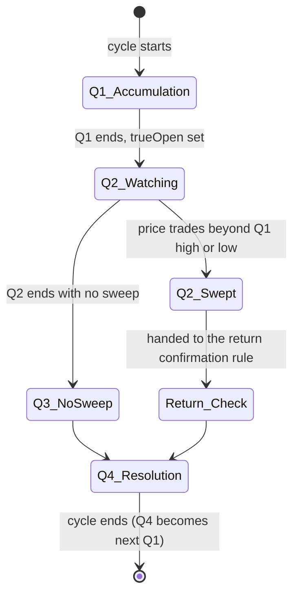

# Rule: Sweep

Part of [[00_rules_engine]]. Framework: [[03_cycle_lifecycle]], windows in [[02_time_model]].

## Idea

Inside a cycle, Q1 forms a range. In Q2 price moves beyond Q1's high or low, which is the **sweep**. The expectation is that the real move (Q3) then goes the opposite way from the sweep.

## Inputs (per instrument, per cycle)

| Value | Captured when |
|-------|---------------|
| `q1High`, `q1Low`, `q1Open` | During and at end of Q1 |
| `trueOpen` | First price of Q2 |
| Bars of Q2 | As they arrive |

## Definition

- **Sweep of the high**: during Q2, price trades above `q1High`.
- **Sweep of the low**: during Q2, price trades below `q1Low`.
- Applies at every level of the grid: the cycle can be a session (quarters of 90 min) or a 90-min quarter (quarters of 22.5 min).
- The daily level is context only: Q1 Asia has no previous session in the same day to sweep.

Example (London session, UTC): Q1 = 04:00-05:30, Q2 = 05:30-07:00. `q1High` and `q1Low` come from 04:00-05:30. Any bar after 05:30 that goes beyond them is a sweep.

## State (sweep part)

## Output

| Field | Value |
|-------|-------|
| `rule` | Sweep |
| `scope` | One instrument |
| `verdict` | `BULLISH` if the low was swept, `BEARISH` if the high was swept, `NEUTRAL` if nothing or both were swept |
| `evidence` | Level, swept price, sweep time, how far beyond the extreme |

## Open questions

- How strict is a sweep: a wick (high/low) beyond the level, or a bar **close** beyond it? With `M1` data a close can only be judged at bar end ([[06_market_data_contract]]).
- Minimum distance beyond the level (any tick, or a threshold)?
- Both Q1 high and Q1 low swept in the same Q2: currently treated as ambiguous (`NEUTRAL`).
